

  <picture>
    <source media="(prefers-color-scheme: dark)" srcset="docs/brand/titanos-wordmark-dark-bg.svg">
    
  </picture>

<strong>Deine Daten. Deine Anwendungen. Deine Startseite.</strong> Ein NAS-Betriebssystem für den eigenen Server – vom USB-Stick gestartet, im RAM betrieben, im Browser verwaltet.

   
  Stick-ZIP, Prüfsummen und Signaturen der jeweils aktuellen Stable-Version.

  <a href="#installation">Installation</a> ·
  <a href="#funktionen">Alle Funktionen</a> ·
  <a href="#dokumentation">Dokumentation</a> ·
  <a href="LICENSE.md">Fair Source</a>

[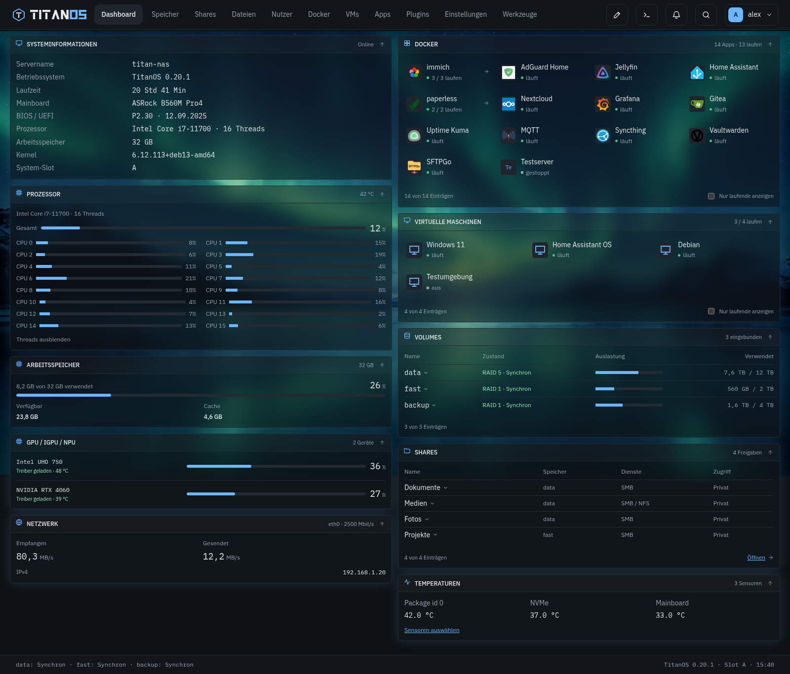](docs/screenshots/current/dashboard.png)

## Ein Server für Dateien, Apps und virtuelle Maschinen

TitanOS macht aus einem x86-64-PC einen zentralen Speicher und Anwendungsserver. Du verwaltest RAID-Volumes, Freigaben, Docker-Apps, virtuelle Maschinen und Sicherungen in einer gemeinsamen Weboberfläche. Dazu kommen ein Dateimanager, Hardware-Monitoring, Home Assistant und ein optionaler KI-Assistent.

Die Startseite passt du an deinen Alltag an: Welche Informationen du siehst, wie viel Platz sie bekommen und wie sie aussehen, bestimmst du selbst. Jede Person hat ihr eigenes Dashboard und ihre eigenen Darstellungseinstellungen.

Das System basiert auf **Debian 13**, startet per UEFI von einem USB-Stick und läuft aus dem Arbeitsspeicher. Nutzdaten, Container und VM-Abbilder liegen auf separaten Daten-Volumes. Die Konfiguration bleibt auf dem Stick; automatische Konfigurationssicherungen helfen beim Austausch eines ausgefallenen Sticks.

Die Bedienidee ist von Unraid inspiriert; TitanOS setzt auf klassisches Linux-Software-RAID und ist ein eigenständiges Projekt ohne Verbindung zu Lime Technology.

**Die Bilder zeigen die echte Weboberfläche mit isolierten Beispieldaten.** Es sind keine Messungen eines produktiven NAS und keine Design-Mockups. Ein Klick öffnet die volle Auflösung. [Aufnahmestand und Erstellung](docs/screenshots/README.md).

## Funktionen

### Deine persönliche Startseite

- **Ein frei gestaltbares Dashboard pro Konto:** Kacheln verschieben, vergrößern, verkleinern, duplizieren, ausblenden, einklappen und an ihrer Position sperren. Ein Positionsraster mit Ziehvorschau und unabhängigen Spalten vermeidet gemeinsame Leerzeilen.
- **Anpassbare Aufteilung:** ein bis vier Spalten und eine Mindestbreite festlegen. Bei schmaleren Fenstern wandern die Inhalte in ihrer Lesereihenfolge nach unten; Kacheln können automatisch wachsen oder eine feste Höhe mit scrollbarem Inhalt bekommen.
- **Gestaltung je Kachel:** Schriftgrößen für Titel, Werte und Beschriftungen, Messwertdarstellung, Farben, Hintergrund, Rahmen, Ecken, Schatten und Abstände. Bei Apps zusätzlich Symbolgröße, Eintragsbreite und Namenszeilen. Stile lassen sich übertragen.
- **Hintergrund und Glas selbst gestalten:** zehn mitgelieferte Motive oder bis zu fünf eigene Bilder pro Konto. Das ganze Bild anzeigen oder Ausschnitt, Position und Zoom wählen. Globale Schieberegler für Transparenz, Blur, Glow mit Farbe und Abdunklung; einzelne Kacheln können eigene Werte behalten.
- **Flüssige Messwerte:** einstellbare, abschaltbare Übergänge für Balken, Ringe und Verläufe; die Bewegungsreduktion des Browsers wird berücksichtigt.
- **Kompakter Schnellzugriff:** Suche, Terminal, Assistent, Benachrichtigungen und Dashboard-Bearbeiten liegen in einer gemeinsamen Fläche oben rechts; das Konto-Menü bleibt separat.
- **Inhalte selbst auswählen:** Systeminformationen einblenden und sortieren; CPU-Threads, Sensoren, Netzwerkschnittstellen und einzelne Geräte oder Anwendungen gezielt anzeigen.
- **Tailnet im Blick:** Die Kachel „Tailscale“ (Besitzer/Administratoren) zeigt die Geräte des Tailnets. Pro Kachel wählst du Geräte und sortierbare Angaben: Online/Offline, Tailscale-IPv4/IPv6, Hostname, MagicDNS-Name, zuletzt gesehen, Betriebssystem, Exit Node, Subnet-Routen und eine Markierung für dieses NAS.
- **NetBird-Netz im Blick:** Die Kachel „NetBird“ (Besitzer/Administratoren) zeigt die Geräte des NetBird-Netzes mit wählbaren, sortierbaren Angaben: verbunden, dieses NAS, NetBird-IP/IPv6, Name (FQDN), letzter Handshake, Verbindungsart (direkt oder über Relay) und Netze; optional nur verbundene Geräte.
- **Direkt am Eintrag handeln:** passende Klickmenüs für Docker, VMs, Shares und Volumes. Docker zeigt die konfigurierten App-Icons; Stacks sind zunächst geschlossen. Details einer VM öffnen sich unmittelbar unter dieser VM.
- **Klare Rückfragen statt Eintippen:** Löschen, Überschreiben, Plattentests, Zwei-Faktor-Zurücksetzen, SSH-Schlüssel und Zertifikate entfernen bestätigt man in einem Dialog, der genau nennt, was passiert. Namen müssen nirgends eingetippt werden; „Abbrechen“ hat den Fokus, Enter löst nie die gefährliche Aktion aus.
- **Visueller Editor mit Vorschau:** Änderungen direkt sehen, rückgängig machen, wiederholen, speichern oder verwerfen.

[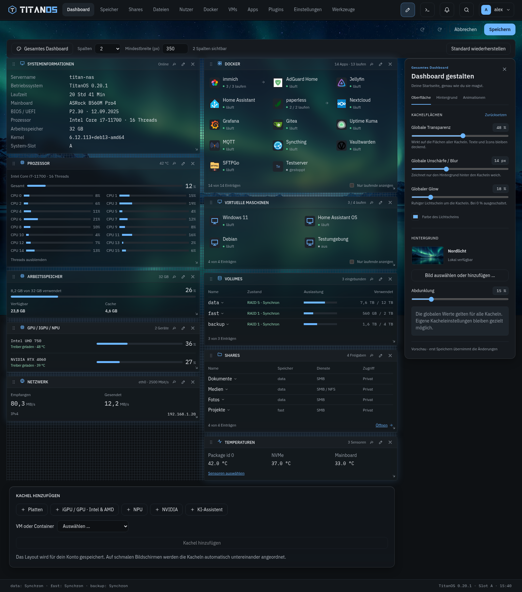](docs/screenshots/current/dashboard-editor.png)

[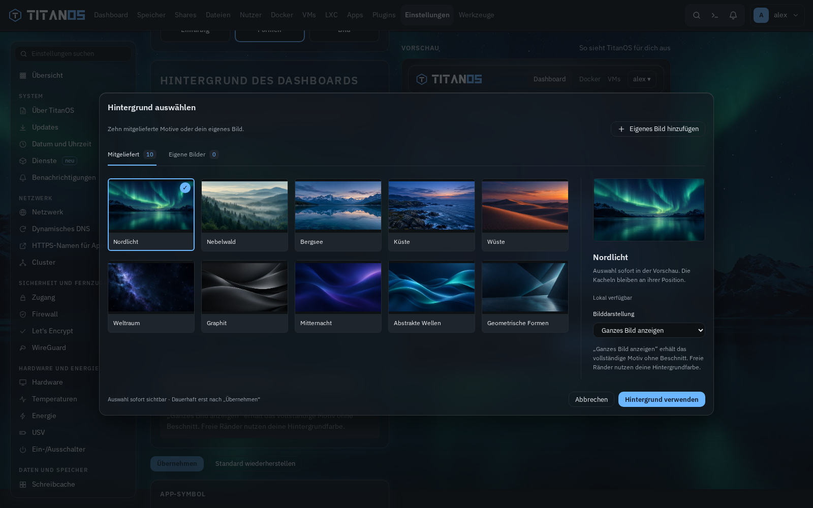](docs/screenshots/current/dashboard-hintergruende.png)

[Eigene Bilder hinzufügen und auswählen](docs/screenshots/current/dashboard-bild-upload.png) · [VM-Details direkt im Dashboard ansehen](docs/screenshots/current/dashboard-vm-details.png).

### Speicher und Laufwerke

- **Klassisches RAID:** mdadm mit RAID 0, 1, 5, 6 und 10; Dateisysteme ext4 und XFS. Volumes anlegen, Zustand und Belegung sehen, Mitglieder ersetzen und Wiederaufbau oder Konsistenzprüfung verfolgen.
- **Btrfs-Spiegel:** native RAID1-Volumes aus genau zwei Platten, schreibgeschützte Snapshots, Scrub und Plattenersatz. Fehlt beim Start ein Mitglied, wartet TitanOS 60 Sekunden auf langsam anlaufende Platten, bevor der Spiegel ohne Redundanz eingebunden und als solcher gemeldet wird. Snapshot-Zeitpläne mit Aufbewahrung sowie Wiederherstellung ganzer Snapshots oder einzelner Dateien in neue Ordner.
- **Vorhandenen Speicher übernehmen:** lesende Vorschau unterstützter mdadm- und Btrfs-Volumes, danach Registrierung ohne Formatierung. RAID5/6 lässt sich um eine Platte erweitern; dafür ist ein separates Rettungs-Volume erforderlich. Hinzufügen, Erweitern und Ersetzen prüfen die gewählte Platte erneut und lassen fremde Arrays, LVM und eingebundene Dateisysteme auf anderen Platten unangetastet.
- **Plattenzustand und Vorbereitung:** SMART, Temperatur, Betriebsstunden, Fehler und Verschleiß; neue Laufwerke vollständig lesen oder überschreiben und zurücklesen, anschließend einen langen Selbsttest ausführen. Einstellbarer Laufwerksruhezustand.
- **Verbrauch verstehen:** kompakte Volume- und Laufwerkslisten mit Details auf Auswahl, Speicheranalyse auf Anforderung und optionale Kapazitätsprognosen aus gültigen Monitoring-Verläufen.

[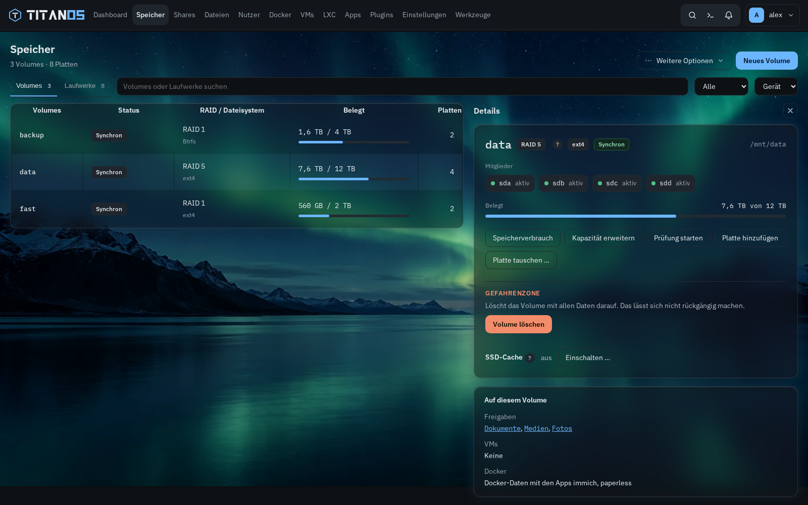](docs/screenshots/current/speicher.png)

[Btrfs](docs/BTRFS.md) · [Übernahme, Erweiterung und Speicheranalyse](docs/WORKFLOWS.md)

### Freigaben und Konten

- **SMB:** Rechte je Konto, lesender Gastzugriff, Papierkorb mit Aufbewahrung und Time-Machine-Ziele. **NFS:** getrennt von SMB abschalten, nur lesend oder lesend/schreibend für ausgewählte Clients freigeben.
- **Übersichtliche Shares:** suchen, filtern und sortieren; Details, Verbindungsadressen und Dateimanager direkt an der Freigabe öffnen.
- **Besitzer, Administratoren und Benutzer:** das erste Besitzerkonto hat einen frei gewählten Namen. Benutzer sehen ihre freigegebenen Dateien; Systemverwaltung, Docker und VMs bleiben den Verwaltungsrollen vorbehalten.
- **Anmeldung und Sicherheit:** Passwortschutz gegen Durchprobieren, TOTP mit Wiederherstellungscodes, Übersicht angemeldeter Geräte und Abmelden einzelner Sitzungen. Konten gelten auch für SMB.

[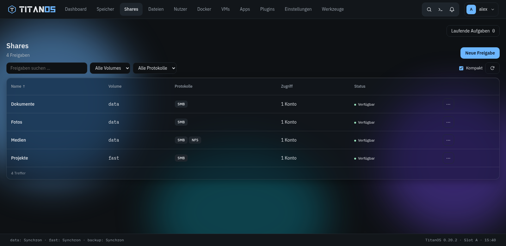](docs/screenshots/current/shares.png)

### Dateien direkt im Browser verwalten

- **Persönlicher Arbeitsplatz:** Ordnerbaum, benannte und sortierbare Favoriten, Ansichten und Sortierung je Ordner, zwei Ordner nebeneinander und eine Pfadeingabe in den Brotkrumen.
- **Dateien und Ordner bearbeiten:** erstellen, hochladen, herunterladen, als ZIP laden, kopieren, verschieben, umbenennen und löschen. Ziehen zwischen Ansichten, Übertragungsvorschau und Entscheidungen bei Namenskonflikten.
- **Von Link herunterladen:** eine HTTP(S)-Adresse, etwa ein ISO-Abbild, lädt das NAS selbst als Hintergrundauftrag in den geöffneten Ordner: optionale SHA-256-Prüfung, Fortsetzen nach Verbindungsabbruch, nie Überschreiben. Benutzerkonten erreichen dabei nur Adressen im Internet.
- **Vorschau und Texteditor:** Bilder, PDF, Audio und Video ansehen; UTF-8-Textdateien bis 512 KiB bearbeiten, einschließlich Markdown, JSON und YAML. Vorige Fassung vergleichen und wiederherstellen.
- **Werkzeuge:** Unterordnersuche, Sammelumbenennen, ZIP-Inhalte, Ordnervergleich, gezielte Übernahme von Unterschieden, Duplikatsuche und Speicheranalyse auf Anforderung.
- **Papierkorb:** Originalpfad, Datum und Belegung sehen, filtern und vor der Wiederherstellung prüfen. Unterstützte Aktionen lassen sich innerhalb der Dienstlaufzeit rückgängig machen.
- **Übertragungen steuern:** Warteschlange, Pause, Priorität, Geschwindigkeitslimit, Fortschritt und Restzeitschätzung. Dauerhaft gespeicherte Kopier-/Verschiebeaufträge auf Daten-Volumes lassen sich nach einem Dienstneustart geprüft fortsetzen. Unfertige Uploads können nach erneuter Dateiauswahl fortgesetzt werden.
- **Große Kopieraufträge:** keine feste Datei- oder GB-Grenze pro Auftrag. Auf Daten-Volumes werden Plan und Wiederaufnahmestand stückweise in einer Datenbank gespeichert; Dateien und Metadaten benötigen ausreichend Zielplatz.
- **Weitere Datenträger:** nicht verwaltete USB-, SATA-, SAS- und NVMe-Dateisysteme ausdrücklich einbinden; FAT32, exFAT, NTFS, ext2/3/4, XFS und Btrfs. Bei NTFS steht zusätzlich ein lesender Ausweichweg bereit. Jede Aktion berücksichtigt Kontorechte und Schreibschutz.

[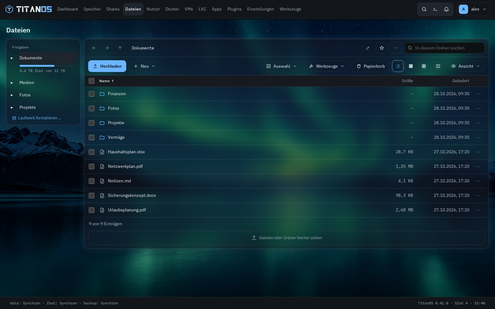](docs/screenshots/current/dateien.png)

[Texteditor und USB-Dateisysteme](docs/FILE-EDITOR.md) · [Von Link herunterladen](docs/FILE-DOWNLOADS.md) · [RAM und Uploads](docs/MEMORY.md) · [Lange Windows-SMB-Pfade](docs/WINDOWS-SMB.md)

### Docker und App-Store

- **Container und Compose-Stacks:** Images und Tags einzeln je Dienst bearbeiten, Store-Vorgaben und Digests erhalten; Start, Stopp, Neustart, Logs und Browserkonsole; CPU, RAM, Ports und geprüfte Updatezustände im Blick. Suche, Filter sowie anpassbare Reihenfolge und Ansicht.
- **Anwendungen schnell öffnen:** eigene App-Icons und Links zur WebUI, zur Tailscale-Adresse und zur öffentlichen Adresse. Bei Stacks bestimmt ein Hauptdienst die gemeinsamen Links.
- **Eigene LAN-Adressen:** ipvlan L2 oder macvlan mit reserviertem IPv4-Pool, optional fester Adresse pro Dienst und eigenem NAS-Endpunkt; private Dienste eines Stacks bleiben privat. [Einrichtung](docs/NETWORKING.md#container-mit-eigener-lan-adresse).
- **Apps als Formular oder Compose bearbeiten:** Ports, Datenpfade, Umgebungswerte und Hardware je Dienst zuweisen. Die Docker-Daten liegen auf einem ausgewählten Daten-Volume.
- **App-Store mit eigenen Quellen:** offizieller [TitanOS-App-Katalog](https://github.com/ra5on/TitanOS-Apps), zusätzliche Repositories, Archive und Compose-Dateien; Unterstützung für CasaOS-kompatible Stores.
- **Installationshilfe:** freie Ports, Zeitzone, Pfade und Geheimnisse vorbereiten und die Herkunft der Feldwerte anzeigen. Eigene Vorlagen für Immich sowie Ollama mit Open WebUI; Container-Abbilder und Modelle werden erst bei Nutzung heruntergeladen.

[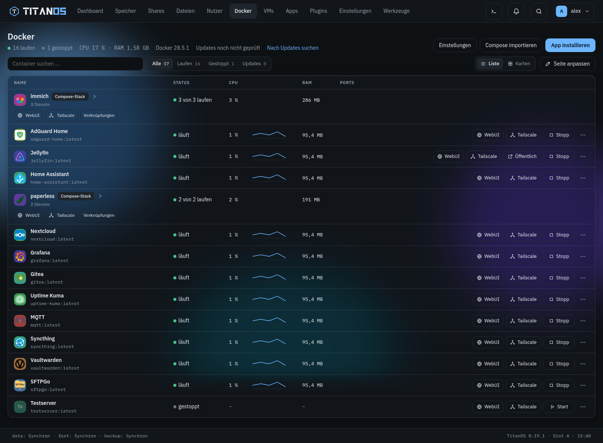](docs/screenshots/current/docker.png)

[App-Links](docs/APP-LINKS.md) · [Immich und Ollama-Vorlagen](docs/NATIVE-APPS.md)

### Virtuelle Maschinen

- **KVM/QEMU und libvirt:** VMs anlegen, starten, sauber herunterfahren und automatisch starten. UEFI als Standard, optional Legacy-BIOS für passende Gäste; Windows 11 mit TPM 2.0 und Secure Boot im Gast.
- **Ressourcen und Datenträger:** CPU-Kerne zuweisen oder reservieren, qcow2/raw und vorhandene Abbilder nutzen, physische Platten einbinden und ausgeschaltete VMs mit neuen Kennungen klonen.
- **Browserkonsolen:** Übersicht, Bildschirm und Snapshots mit gemeinsamer Bedienleiste und bündiger VM-Liste. VNC zeigt ausschließlich das Gastbild; Tastenkombinationen, Text senden, Vollbild und Bildschirmfoto bleiben außerhalb der Bildfläche erreichbar. Der Bildschirm gilt als Konsole: öffnet mit der bestehenden Anmeldung, endet nach 15 Minuten ohne Eingabe und beim Abmelden. Serielle Konsole und ISO-Wechsel im laufenden Betrieb.
- **Netzwerk und Geräte:** bestätigte benannte NAS-Bridges mit eigener Gast-IP oder QEMU-User-Networking; erkannte IP-Adressen, PCI/GPU-/USB-Passthrough und Ordnerfreigaben per virtiofs. Eine Grafik wird nur übergeben, wenn kein Programm des NAS sie noch nutzt; bei der Start-iGPU wird die Textkonsole vorher gelöst und danach zurückgegeben, damit das NAS dabei nicht hängen bleibt.
- **Installationsmedien und Abbilder:** Browser-Upload oder HTTP(S)-Import, gzip/xz/ZIP auf dem Daten-Volume entpacken, Prüfsummen und kontrollierte Wiederaufnahme. Offizielle stabile Windows-VirtIO-ISO automatisch als zweites CD-Laufwerk einlegen. [Medienimport und Grenzen](docs/VM-MEDIA.md).
- **Snapshots:** VM-Datenträger, Konfiguration und bei unterstützten Gästen RAM-Zustand, UEFI und TPM sichern und zurücksetzen. Zeitpläne, Aufbewahrung und Wiederherstellungsstatus; Voraussetzungen und Ausschlüsse werden angezeigt.

[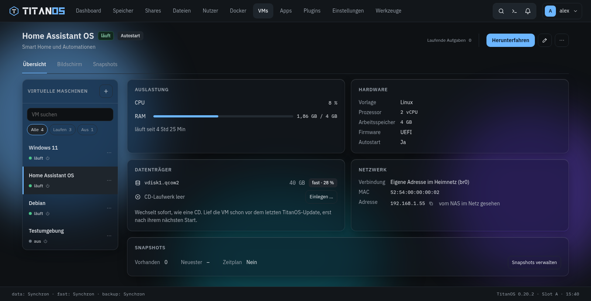](docs/screenshots/current/vms.png)

[VM-Snapshots und Grenzen](docs/VM-SNAPSHOTS.md) · [Bridge-Netzwerk](docs/NETWORKING.md)

Die VM-Einrichtung zeigt kompakte Kacheln mit einer gemeinsamen Zusammenfassung. Die Heimnetz-Bridge `br0` wird bei der Ersteinrichtung automatisch vorbereitet und nach Verbindungsbestätigung dauerhaft übernommen; bestehende NAS aktivieren sie direkt aus der VM-Einrichtung.

### Sicherungen und Wiederherstellung

- **Versionierte Backups mit restic:** Freigaben verschlüsselt auf ein anderes Volume, per SFTP, zu S3 oder zu einem restic-REST-Server sichern. Zeitpläne, Aufbewahrung, Zielprüfung und Fortschritt.
- **Wiederherstellung prüfen:** Archivprüfungen und echte Wiederherstellungsproben; ganze Stände oder einzelne Dateien als neue Kopie in einen eigenen Ordner zurückholen.
- **Anwendungen mit sichern:** ausgewählte Container und VMs sauber anhalten und anschließend wieder starten; optional PostgreSQL exportieren. Sicherungsabdeckung zeigt, welche ausgewählten Shares, Container und VMs berücksichtigt werden.
- **Geführte Anwendungswiederherstellung:** Daten zuerst in einen neuen Ordner holen, vorhandene historische Anwendungsinformationen prüfen und die Übernahme ausdrücklich abschließen. Ungeklärte unterbrochene Vorgänge werden zur Prüfung angezeigt.
- **Direkt lesbare Kopie-Backups:** neue und geänderte Dateien auf USB oder ein SMB-Ziel übertragen, sofort oder nach Zeitplan. Keine Versionierung; am Ursprung gelöschte Dateien bleiben am Ziel. Die SMB-Ordnerkopie trägt ein Beta-Label.
- **Systemkonfiguration sichern:** automatische gebündelte Sicherung auf einem Daten-Volume, Download und Wiederherstellung bei der Ersteinrichtung eines Ersatzsticks. Die Konfigurationssicherung enthält keine Nutzdaten.

[Backup- und Wiederherstellungsabläufe](docs/WORKFLOWS.md) · [USB-Kopie](docs/USB-COPY-BACKUPS.md) · [SMB-Kopie](docs/SMB-COPY-BACKUPS.md)

### Wartung, Monitoring und Diagnose

- **Wartungspläne:** gemeinsame Zeitfenster mit Zeitzone; RAID-Prüfungen, Btrfs-Scrub, SMART-Langtests, Backup-Prüfungen, Wiederherstellungsproben und Snapshot-Aufbewahrung. Abhängigkeiten, optionaler Backup-Vorrang und sichtbare Wartegründe.
- **Auftragsübersicht:** laufende und bekannte abgeschlossene Vorgänge filtern, Fehler prüfen und unterstützte Aufträge pausieren, abbrechen oder fortsetzen. Eigene KI-Aufträge, Automationen und Uploads einsehen.
- **Live-Monitoring:** CPU und Threads, RAM, Netzverkehr, Volumes, Laufwerke, Temperaturen und Beschleuniger. Kurze Verläufe im RAM; optional sieben oder 30 Tage auf einem Daten-Volume, mit CSV-/JSON-Export. Fehlende Werte bleiben unbekannt.
- **RAM-Verwaltung:** verfügbarer RAM, Dateicache und übrige Belegung getrennt sehen; Hinweise bei anhaltender Speicherknappheit und optionale PSI-Wartezeiten. Linux verwaltet Lesecache automatisch. Das einstellbare Schreibpufferbudget und begrenzte Upload-Fenster orientieren sich an verfügbarem Arbeitsspeicher und einer Systemreserve.
- **Protokolle und Diagnose:** Systemjournal im Browser nach Quelle und Stufe filtern; ein Diagnosepaket mit Systemzustand und Filterung bekannter sensibler Felder erstellen. Vor dem Weitergeben bleibt eine eigene Prüfung sinnvoll.
- **Obergrenzen für Freigaben:** auf ext4- und XFS-Volumes vom Kernel durchgesetzte Grenze pro Freigabe für SMB, NFS, Apps und Dateimanager; Windows sieht sie als Laufwerksgröße. Einmal pro Volume einschalten, wirksam nach dem nächsten Neustart; nicht auf Btrfs. [Einzelheiten](docs/SHARE-QUOTAS.md).
- **Aktivitätsprotokoll:** wer wann was geändert hat – Anmeldungen und Fehlversuche, Einstellungen, Dateiaktionen mit Pfaden, Konsolen, Apps und VMs. Filter nach Konto, Zeitraum und Fehlschlägen, Export als CSV/JSON. Liegt mit Aufbewahrungsdauer und Größengrenze auf einem Daten-Volume; Passwörter, Schlüssel und Dateiinhalte werden nie gespeichert. [Einzelheiten](docs/ACTIVITY.md).

[Monitoring](docs/MONITORING.md) · [Wartung und Aufträge](docs/WORKFLOWS.md) · [RAM-Verwaltung](docs/MEMORY.md)

### GPU, iGPU, NPU und Plugins

- **Stabile Hardwarebasis:** Intel-/AMD-CPU-Microcode für frühes Laden, gezielte Netzwerk-/HBA-Firmware und geprüfte Intel-i915/xe-/NPU- sowie AMD-Grafikmodule und Firmware. [Umfang und Hardware-Prüfgrenzen](docs/HARDWARE-COMPATIBILITY.md).

- **Hardware für Apps auswählen:** stabile Gerätekennungen für Intel-/AMD-Grafik, NVIDIA, NPU und Coral USB; Zuordnung je Container-Dienst.
- **Treiber und Werkzeuge als Plugins:** signierter Katalog, Installation auf einem Daten-Volume und zur Systembasis passende Pakete. Plugin-Dateien und Einstellungen bleiben beim System-Rückfall getrennt erhalten. Neuere Fassungen aus einer Freigabe lassen sich auf der Plugin-Seite aktualisieren, mit Rückweg, falls sie nicht starten.
- **Beschleuniger beobachten:** Auslastung, Temperatur, Leistung, Speicher, Takt und Engines, soweit Gerät und Treiber diese Werte liefern. Nicht verfügbare Messwerte werden nicht als null ausgegeben.
- **NVIDIA:** passendes Treiber-Plugin, Leistungslimit und optionaler geregelter Wechsel zwischen VM und GPU-Containern. Öffentliche Treiber lassen sich auf dem NAS vorbereiten und ausdrücklich beim Neustart aktivieren.
- **Intel GPU Tools und Coral USB:** zusätzliche Diagnose und Geräteerkennung. Die Coral-Laufzeit stellt die jeweilige Container-App bereit; PCIe-/M.2-Coral ist nicht unterstützt.

[Plugins und Gerätezuordnung](docs/PLUGINS.md) · [NVIDIA](docs/NVIDIA.md) · [Lokaler NVIDIA-Bau](docs/NVIDIA-LOCAL-BUILD.md)

### Home Assistant und MQTT

- **NAS-Werte per MQTT-Discovery:** System, Volumes/RAID, Laufwerke, Container, Stacks, VMs, Netzwerk, Backups, Wartung, Kapazitätsprognosen und USV sowie GPU, iGPU und NPU.
- **Gezielt veröffentlichen:** Gruppen und einzelne Geräte auswählen. Stabile Kennungen, Verfügbarkeit, Ablaufzeiten und Bereinigung entfernter Entitäten; keine zusätzlichen SMART-Abfragen zum Aufwecken schlafender Platten.
- **Optionale Knöpfe:** Container, VMs und eingerichtete Backups steuern, Updates prüfen sowie NAS-Neustart und Herunterfahren auslösen. Die Rechte des ausgewählten Kontos gelten auch hier.
- **Freigegebene HA-Geräte im Assistenten:** ganze Bereiche oder einzelne Geräte mit Aliasnamen und Fähigkeiten erlauben, Zustände lesen, erlaubte Dienste aufrufen und Zielzustände prüfen; begrenzte Rücknahme unterstützter Schaltvorgänge.
- **Automationen und Assist:** Zustandswechsel, Schwellwerte und Bedingungen als Auslöser; Recorder-Historie, Fragen per Assist und optionale native Gesprächsintegration. Benachrichtigungen über die Home-Assistant-App mit passenden Aktionen.

[Home-Assistant-Anleitung, Einrichtung und Prüfgrenzen](docs/HOME-ASSISTANT.md)

### Optionaler KI-Assistent

- **Ollama anbinden:** ein eigenes oder selbst gehostetes Werkzeugmodell nutzen; ab Werk ausgeschaltet. Chats mit laufender Antwortausgabe, persönliche Verläufe auf einem Daten-Volume und Schnellzugriff per Strg+J.
- **Das NAS befragen und verwalten:** Systemzustand, Speicher, Freigaben, Docker, VMs, Backups, Protokolle, Dateien und Handbuch einbeziehen; optional Websuche. Lese- und Änderungsrechte pro Bereich festlegen.
- **Aufträge laufen auf dem NAS:** Änderungen nach Freigabe, optional ausdrücklich im Direktmodus; Probelauf, Pause, Stopp, Fortsetzen, Prioritäten, Abhängigkeiten und Checkpoints. Das Schließen des Browsers beendet den Auftrag nicht. Unbekannte Änderungsausgänge werden nicht automatisch wiederholt.
- **Persönliches Wissen:** explizite Notizen, Vorlagen, Projekte und ausgewählte Quellordner mit gezielter Suche. Systemprompt, Modellprofile, Kontextvorschau, Modelltests und Statistik je Chat.
- **Dokumente:** Word-, Excel-, PDF- und Textdateien erzeugen; PDF-Text und optionale OCR lesen. Unterstützte Word-/Textänderungen und Excel-Wertzellen als neue geprüfte Kopien speichern; Formeln bleiben geschützt.
- **Automationen:** einmalig, nach Intervall, täglich oder wöchentlich mit Zeitzone sowie durch Meldungen, USB-, Volume-, Ordner- und Home-Assistant-Ereignisse. Vorlagen, Bedingungen, Zeitfenster, Hysterese und Versionsverlauf.
- **Private Benachrichtigungen:** je Konto Freigaben, Ergebnisse oder Blockierungen melden, mit Zusammenfassung, Ruhezeiten und optionalem Ersatzkanal. Optional Freigeben/Ablehnen über ntfy oder die HA-App; zerstörerische Aktionen bleiben davon ausgeschlossen.

[KI-Assistent: Bedienung, Rechte und Grenzen](docs/ASSISTANT.md) · [Wissen, Dokumente und Automationen](docs/ASSISTANT-EXPANSION.md)

### API und Automatisierung

- **Persönliche API-Zugänge:** benannte, widerrufbare Tokens mit bewusst gewählten Bereichen und aktuellen Konto-/Share-Rechten. Standard nur lesend, Geheimnis einmalig sichtbar, ausschließlich sein Hash wird gespeichert.
- **OpenAPI und CLI:** dokumentierter API-Vertrag und statisches `titanosctl` für Status, Dateien sowie erlaubte Docker-/VM-Aktionen. [Verwendung](docs/PUBLIC-API.md).

### Netzwerk, Energie und Systemzugang

- **Netzwerk:** mehrere benannte Netze über Anschlüsse, Bonds und VLANs; IPv4-DHCP/feste Adressen, IPv6-SLAAC/DHCPv6/feste Adressen, DNS und Routen. Bevorzugter Verwaltungszugang, zweiminütiger Probelauf und authentifizierte lokale Wiederherstellung. Router und DHCP bleiben extern.
- **Tailscale als Plugin:** Fernzugriff, Subnet-Routing und Exit-Node-Betrieb in beiden Rollen; Routen- und DNS-Einstellungen mit Rückfall. Eine Dashboard-Kachel listet die Geräte des Tailnets.
- **NetBird als Plugin:** Fernzugriff über NetBird Cloud oder einen eigenen Management-Server, Anmeldung per Setup-Key (wird nie wieder angezeigt), Routen, Routing-Peer/Exit Node und DNS mit zweiminütigem Rückfall; Dashboard-Kachel mit den Geräten. Ausgeliefert wird nur der BSD-lizenzierte Client.
- **Energie und USV:** CPU-Profile, Herunterfahren und Einschalten per RTC-Zeitplan, Wake-on-LAN und Verhalten des physischen Ein-/Ausschalters. USB- oder Netzwerk-USV über NUT, Abschalten bei Stromausfall und Weitergabe des USV-Status.
- **HTTPS:** dauerhaftes selbst signiertes Zertifikat ab dem ersten Start oder eigene PEM-Zertifikate samt Schlüssel und Kette importieren.
- **Terminal und SSH:** NAS-Shell und Docker-Konsolen als Browser-Tabs für Besitzer/Administratoren. SSH ist zunächst ausgeschaltet; nach Aktivierung Anmeldung mit eigenem Konto und Schlüssel, bei Bedarf `sudo`. Linux-root ist für direkte Anmeldung gesperrt. Offene Konsolen enden innerhalb weniger Sekunden nach Abmelden, Kontolöschung, Herabstufung oder Passwort-Zurücksetzen; ein entfernter SSH-Schlüssel beendet auch die SSH-Sitzungen des Kontos.
- **Benachrichtigungen:** Meldungszentrale mit persönlichen Filtern sowie E-Mail, ntfy, Telegram, Discord und Home-Assistant-App für Systemereignisse. Eigene ntfy-/Discord-Ziele normaler Benutzerkonten erreichen nur öffentliche Adressen, nicht das Heimnetz.

[Netzwerk](docs/NETWORKING.md) · [Tailscale](docs/TAILSCALE.md) · [NetBird](docs/NETBIRD.md) · [Ein-/Ausschalter](docs/POWER-BUTTON.md)

### Einstellungen, Darstellung und mobile Bedienung

- **Geordnete Einstellungen:** fünf Themenbereiche, kompakte alphabetisch sortierte Kacheln und gezielte Suche. Sicherungen bündeln Datenbackups, Konfigurationssicherung und Wiederherstellung.
- **Themes:** Graphit, Schwarz, Mitternacht, Hell, Automatik und eigene Farben; Akzent, Hintergrund, Transparenz, Glas-Effekt, Unschärfe, Eckenradius, Dichte und Schriftgröße einstellen. Darstellung exportieren und importieren.
- **Deutsch und Englisch**, lokale Schriftdateien, Tastatur- und Touch-Bedienung, mobile Navigation und rollenabhängige Befehlspalette per Strg/⌘+K.

[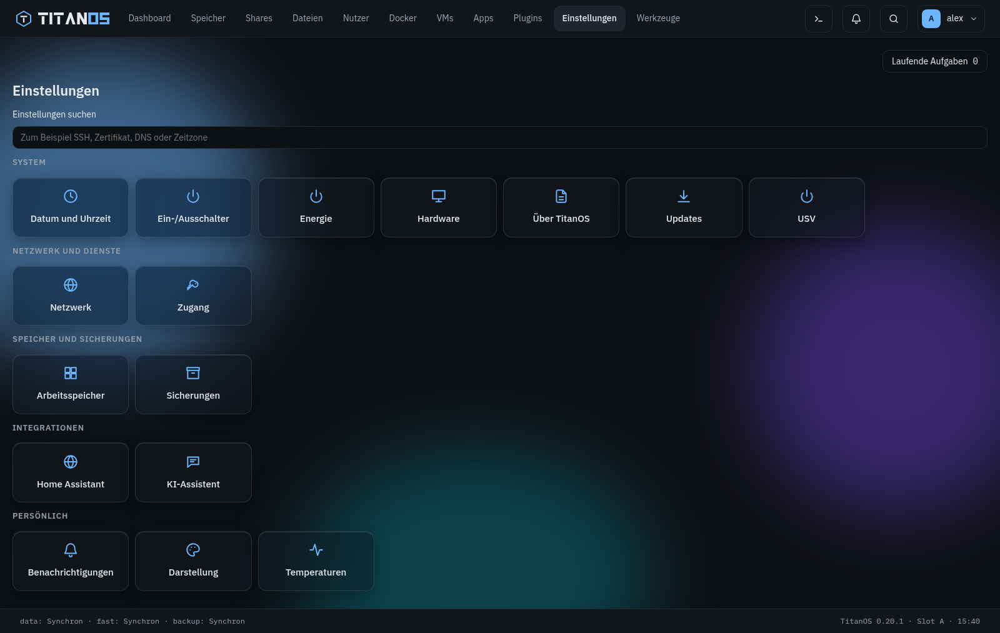](docs/screenshots/current/einstellungen.png)

  <a href="docs/screenshots/current/dashboard-mobil.png">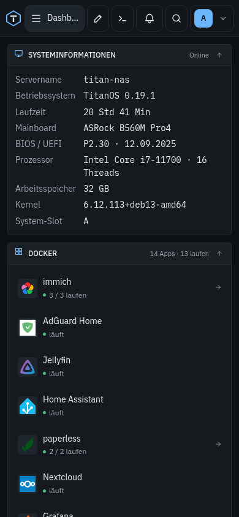</a>
  <a href="docs/screenshots/current/dateien-mobil.png">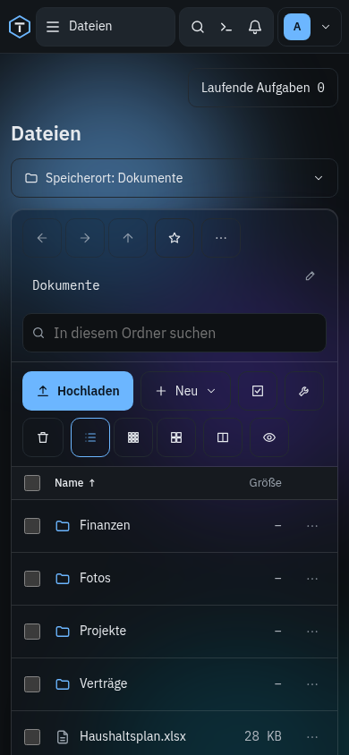</a>

### Updates mit geprüftem Rückfall

TitanOS nutzt einen **Stable-Kanal**. Die Weboberfläche prüft und installiert Updates manuell oder nach Zeitplan; nach einer Verwaltungsanmeldung kann eine Prüfung im Hintergrund erfolgen.

- **Kompatible App-Updates** ersetzen nur TitanOS mit seiner Weboberfläche, ohne Neustart des NAS. Container, VMs und Freigaben laufen weiter; die Anmeldung bleibt erhalten. Bei fehlgeschlagenem Probestart folgt der Rückfall zur vorigen App oder Systembasis.
- **Volle Systemupdates** erneuern auch Kernel und Systempakete. Sie werden in den inaktiven A/B-Slot geschrieben und starten auf Probe. Scheitert die Startprüfung wiederholt, bootet der vorherige Slot.
- **Signatur und Integrität sind Pflicht:** nur gültig signierte Manifeste und passende Datei-Prüfsummen werden angenommen. Laufende relevante Daten- und Wartungsvorgänge blockieren die Installation bis zu ihrem Abschluss.

[App-Updates](docs/APP-UPDATES.md) · [Release-Dateien, Signaturen und Prüfung](docs/RELEASING.md)

## Voraussetzungen und aktuelle Grenzen

| Bereich | Voraussetzung |
|---|---|
| Rechner | x86-64/amd64 mit UEFI; Secure Boot für das NAS ausgeschaltet |
| Arbeitsspeicher | Für erste Tests 4 GB einplanen, zusätzlich RAM für Apps und VMs; keine pauschal abgenommene Hardware-Mindestgröße |
| Bootmedium | USB-Stick mit 8–32 GB, FAT32, Label `TITANOS` |
| Nutzdaten | Separate Laufwerke; ein neues Volume löscht die ausgewählten Platten |
| Netzwerk | Kabelgebunden, beim ersten Start DHCP |
| Virtualisierung | Für VMs aktivierte Hardware-Virtualisierung; Passthrough benötigt passende IOMMU-/Geräteunterstützung |

RAID ersetzt kein Backup. Unterstützung und Messwerte hängen von Kernel, Firmware und konkreter Hardware ab; das gilt auch für GPUs, NPUs, USVs und externe Backupziele. Die Release-Prüfungen umfassen automatisierte Tests und virtuelle NAS-Systeme, keine vollständige Abnahme aller Geräte und Dienste. Die genauen Ergebnisse stehen in den [Release-Berichten](docs/releases/).

ARM, ZFS, LUKS-Volume-Verschlüsselung, automatische Let's-Encrypt-Zertifikate sind nicht enthalten. Der Bootloader wird bei Updates nicht automatisch ersetzt; volle Systemupdates aus einer hochgeladenen Datei sind nicht umgesetzt. TitanOS ist für ein vertrauenswürdiges lokales Netz gedacht; eine konfigurierbare Paketfilter-Firewall ist derzeit nicht enthalten. [Netzwerkverhalten](docs/NETWORKING.md#firewall-derzeit-ausgeschaltet).

## Installation

1. Auf der [aktuellen Stable-Release-Seite](https://github.com/ra5on/TitanOS/releases/latest) das Stick-ZIP `titanos-<version>.zip` sowie dessen `.minisig` und `.sha256` herunterladen. Die Signatur mit [minisign](https://jedisct1.github.io/minisign/) und einem vertrauenswürdig bezogenen [Release-Schlüssel](build/mkosi.extra/usr/share/titanos/update-keys/) prüfen. [Download-Prüfung](docs/RELEASING.md#downloads-prüfen).
2. Einen leeren USB-Stick als **FAT32** mit dem Label **`TITANOS`** formatieren. Das ZIP direkt ins Stammverzeichnis entpacken. Dort liegen anschließend `EFI`, `loader`, `titanos` und `config`.
3. Per **UEFI, Secure Boot aus**, vom Stick starten. Die DHCP-Adresse steht auf der Konsole oder im Router. Im Browser **`https://<nas-ip>`** öffnen; das selbst signierte Zertifikat erzeugt zunächst eine Browserwarnung.
4. Bei einer Neuinstallation das Besitzerkonto anlegen, Sprache, Hostname und Zeitzone einstellen. Unter **Speicher** ein Volume anlegen und unter **Shares** eine Freigabe erstellen. Konfigurationssicherung und Zwei-Faktor-Anmeldung einrichten.

Ein vorhandenes NAS unter **Einstellungen › Updates** aktualisieren. Den eingerichteten Stick dafür nicht neu formatieren.

### Einen ausgefallenen Stick ersetzen

Einen neuen Stick wie oben vorbereiten und beim ersten Start **vor dem Anlegen eines neuen Kontos** die gefundene Konfigurationssicherung wiederherstellen. TitanOS sucht lesend auf unterstützten Volumes nach Sicherungen unter `.titanos/backups/`. Nach Wiederherstellung und Neustart werden die registrierten Volumes wieder eingebunden.

Die Datenplatten nicht als neue Volumes anlegen oder formatieren. Ohne Konfigurationssicherung können unterstützte bestehende mdadm-/Btrfs-Volumes über **Speicher › Weitere Optionen › Speicher übernehmen** registriert werden; Konten, Freigaben und sonstige Einstellungen müssen neu eingerichtet werden. Das ist kein Import beliebiger fremder Speichersysteme. [Voraussetzungen zur Übernahme](docs/WORKFLOWS.md).

## Dokumentation

| Thema | Einstieg |
|---|---|
| Speicher, Sicherungen und Wartung | [Abläufe und Grenzen](docs/WORKFLOWS.md), [Btrfs](docs/BTRFS.md), [VM-Snapshots](docs/VM-SNAPSHOTS.md) |
| Dateien und Übertragungen | [Dateieditor](docs/FILE-EDITOR.md), [RAM/Uploads](docs/MEMORY.md), [Windows-SMB](docs/WINDOWS-SMB.md) |
| Hardware und Fernzugriff | [Plugins](docs/PLUGINS.md), [NVIDIA](docs/NVIDIA.md), [Tailscale](docs/TAILSCALE.md), [NetBird](docs/NETBIRD.md), [Netzwerk](docs/NETWORKING.md) |
| API und Medien | [Öffentliche API/CLI](docs/PUBLIC-API.md), [VM-Medien](docs/VM-MEDIA.md), [Plugin-Aufräumen](docs/PLUGIN-CLEANUP.md) |
| Integrationen | [Home Assistant/MQTT](docs/HOME-ASSISTANT.md), [KI-Assistent](docs/ASSISTANT.md) |
| Entwicklung und Veröffentlichung | [Release-Ablauf](docs/RELEASING.md), [UI-Entwürfe](docs/design/README.md), [Screenshots](docs/screenshots/README.md) |
| Änderungen und Prüfstand | [GitHub Releases](https://github.com/ra5on/TitanOS/releases), [detaillierte Release-Berichte](docs/releases/) |

## Entwicklung

Backend: **Go**, ein statisches `titand`-Binary. Oberfläche: **Svelte + TypeScript**, im Release in das Binary eingebettet. Das Systemabbild entsteht mit mkosi auf Debian 13.

Voraussetzungen: Go 1.27+, Node.js 24+, Python 3.11+ und `make`. Für Systemabbilder zusätzlich mkosi 25.3, `debian-archive-keyring squashfs-tools zstd zip systemd-container`; für Release-Prüfungen `minisign`, für virtuelle Starts `qemu-system-x86 ovmf mtools fdisk`. Die [Entwicklungsanleitung](docs/DEVELOPMENT.md) beschreibt die geprüfte Fedora-44-Einrichtung mit festen Toolchains, GitHub-Anbindung, vollständigem Abbildbau und reproduzierbaren QEMU-Tests für RAID, Docker-Apps und VMs. Details zu Signierung und Veröffentlichung: [RELEASING.md](docs/RELEASING.md).

| Befehl | Ergebnis |
|---|---|
| `make build` | Weboberfläche, `backend/bin/titand` mit eingebetteter UI und `backend/bin/titanosctl` bauen |
| `make test` | Go vet/Tests, Webtests und Svelte-/TypeScript-Prüfung ausführen |
| `make test-release` | Paketierung, Lizenzinventar, Signaturen und Manipulationserkennung prüfen |
| `node scripts/test-ui-*.mjs` | Browserprüfungen mit isolierten Testdaten gegen `npm --prefix web run preview` (Playwright, `UI_URL`, `PLAYWRIGHT_MODULE`) |
| `node scripts/test-ui-crawl.mjs` | Jede Seite eines `titand -dev` öffnen und jeden Knopf klicken, um Darstellungsfehler zu finden (`UI_URL`, `UI_LOGIN=name:passwort`) |
| `make dev` | Backend im Entwicklungsmodus und Vite mit automatischem Neuladen starten |
| `make zip` | Systemabbild und bootfähigen Stick-Inhalt unter `out/` bauen |
| `make zip-dev` | Entwicklungsabbild mit automatischer root-Anmeldung an der lokalen Konsole bauen |
| `make qemu` | UEFI-Testsystem starten; `DISKS=4 make qemu` fügt vier leere virtuelle Testplatten hinzu |

Der Entwicklungsmodus verändert keine Host-Platten. In `backend/` funktionieren `go build ./cmd/titand` und `go test ./...` ohne Node.js; ohne Build-Tag `embedui` wird eine Platzhalterseite ausgeliefert. Für Abbild-Builds sind funktionierende Benutzer-Namespaces mit `newuidmap`/`newgidmap` und passenden `/etc/subuid`-/`/etc/subgid`-Einträgen nötig, alternativ `MKOSI_SUDO=1 make zip`.

## Lizenz und Beiträge

TitanOS ist **Fair Source** unter der [Functional Source License 1.1 (FSL-1.1-ALv2)](LICENSE.md). Nutzen, Ändern und Weitergeben ist privat, im Unternehmen, für Lehre und Forschung erlaubt. Ausgenommen ist das Anbieten eines konkurrierenden kommerziellen Produkts oder Dienstes. Jede Version wechselt zwei Jahre nach ihrem Erscheinen zur **Apache License 2.0**. Maßgeblich ist der unveränderte Lizenztext.

Fremdkomponenten behalten ihre eigenen Lizenzen. Jedes Release enthält ein Lizenzinventar und Quellpaketverweise; die Übersicht steht in [THIRD_PARTY_LICENSES](THIRD_PARTY_LICENSES). Abgebildete App-Namen und Logos gehören den jeweiligen Projekten.

Beiträge sind willkommen: [CONTRIBUTING.md](CONTRIBUTING.md) erklärt den Ablauf und das Contributor License Agreement. Sicherheitslücken bitte wie in [SECURITY.md](SECURITY.md) beschrieben privat melden.
