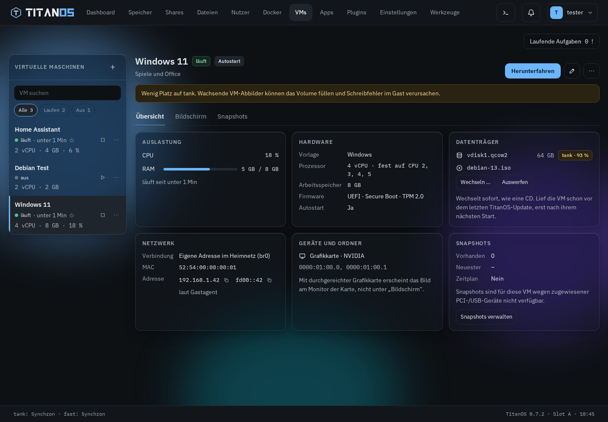
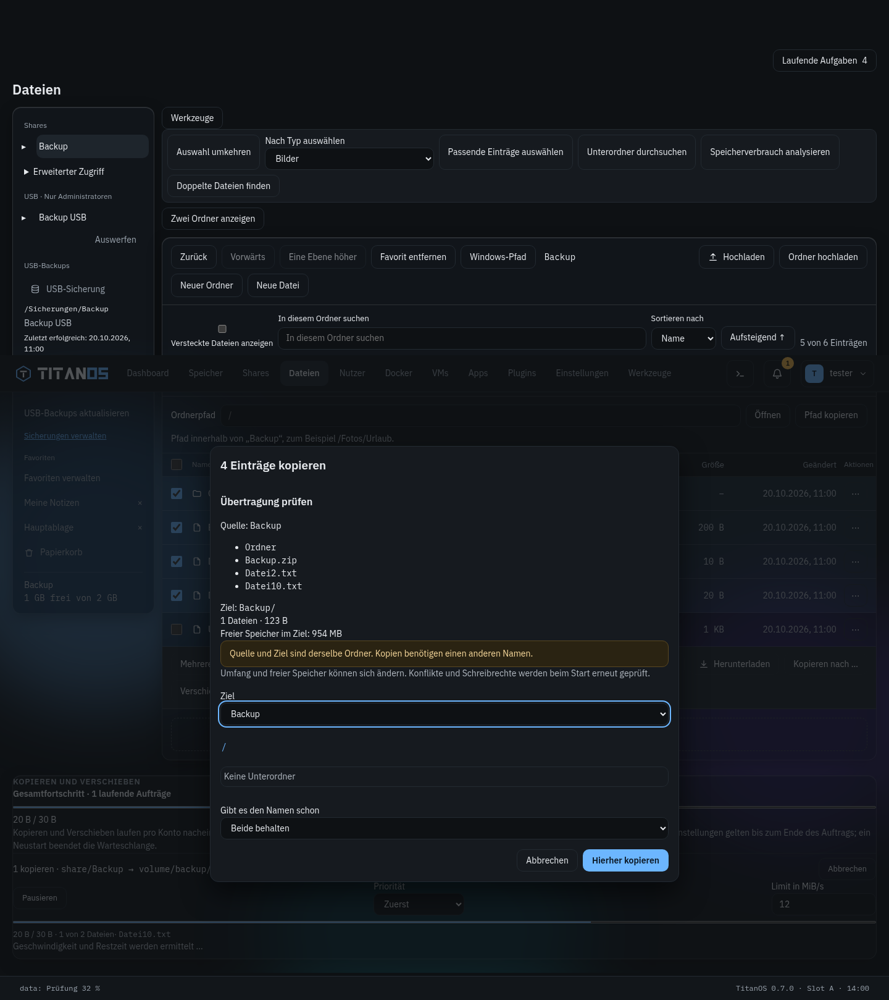
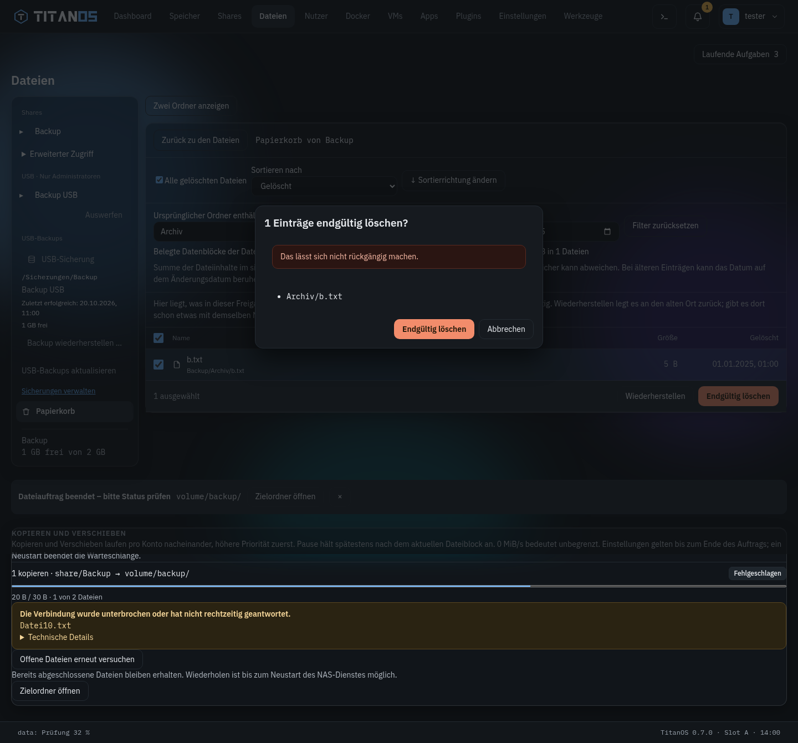
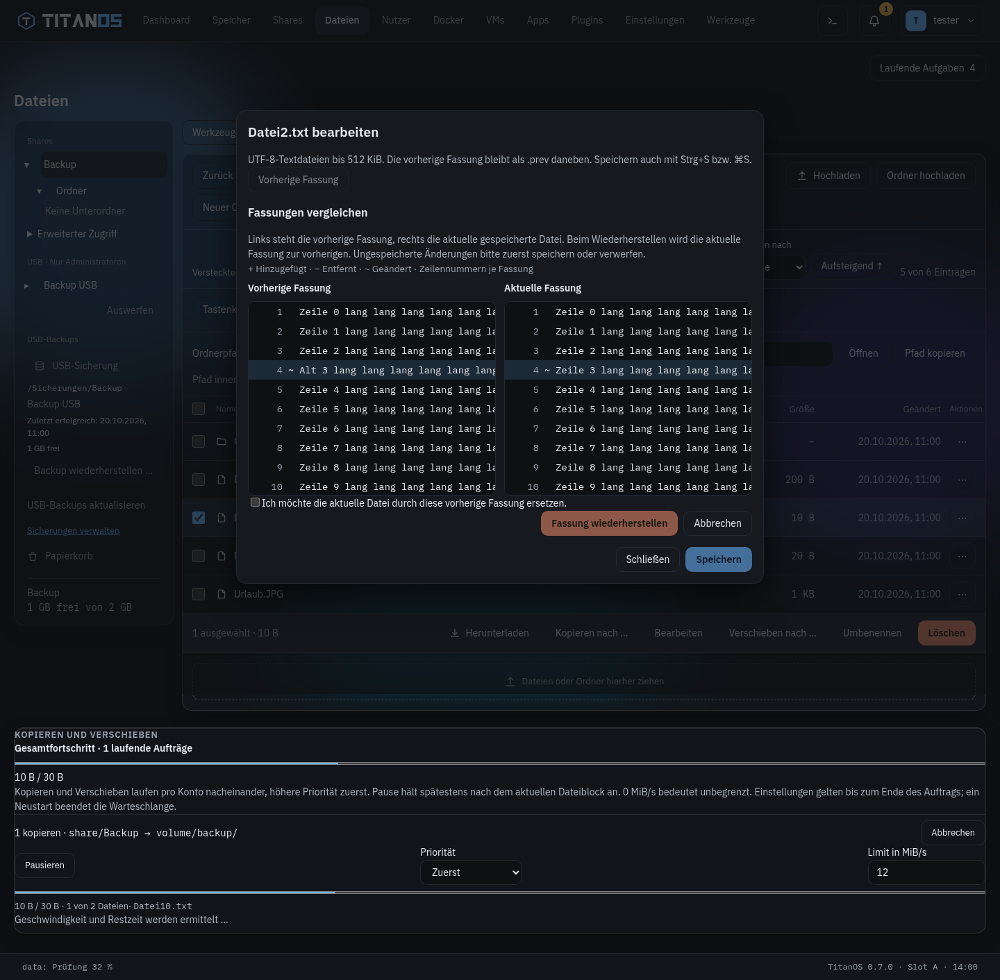
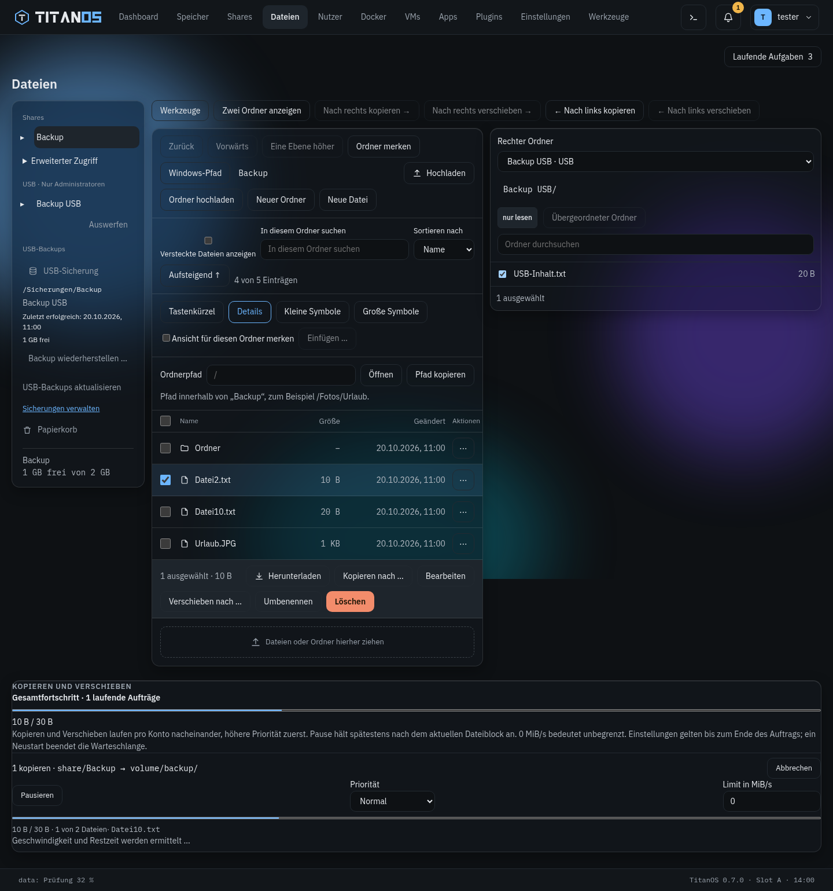
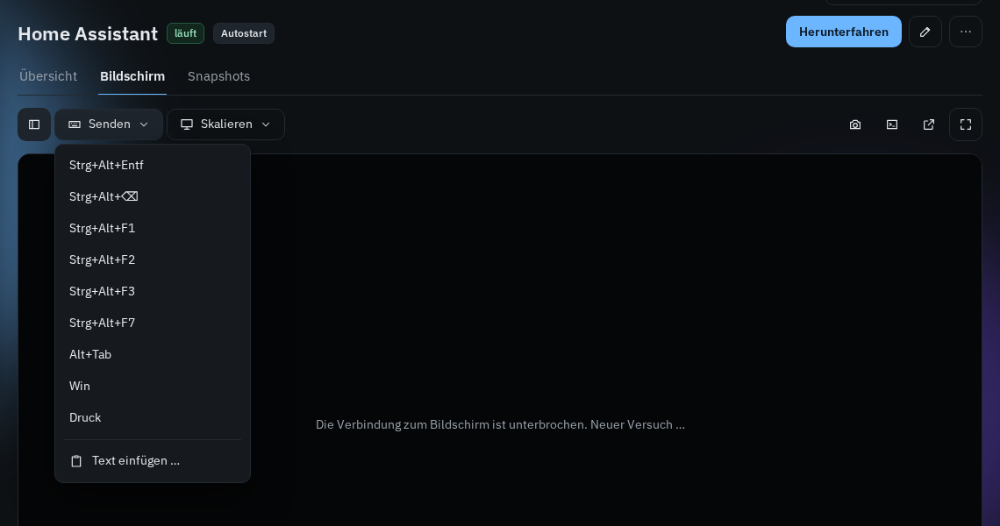
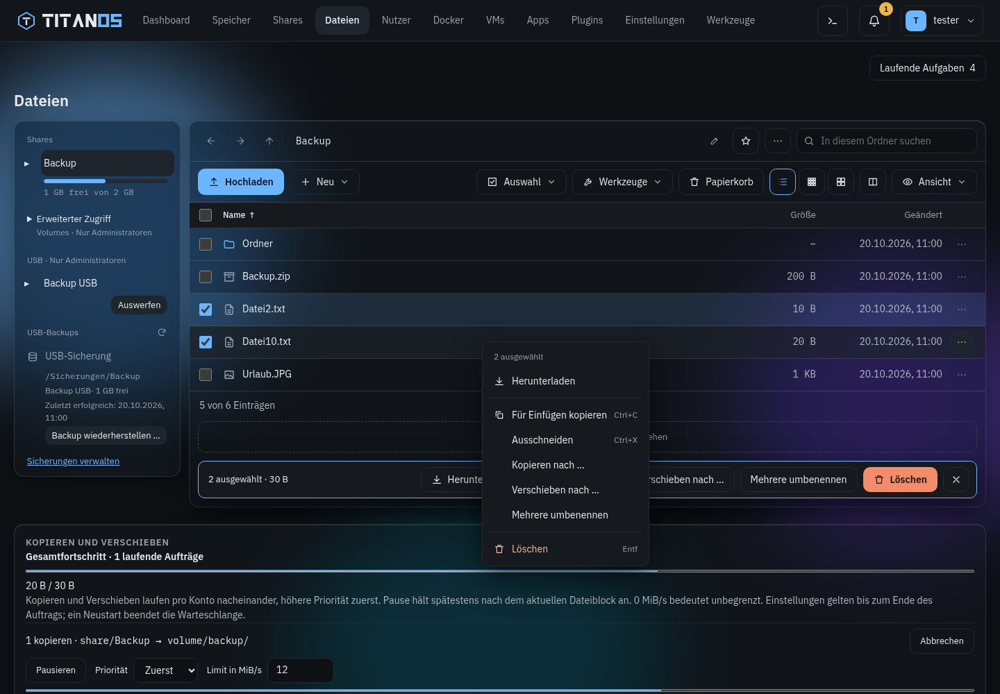
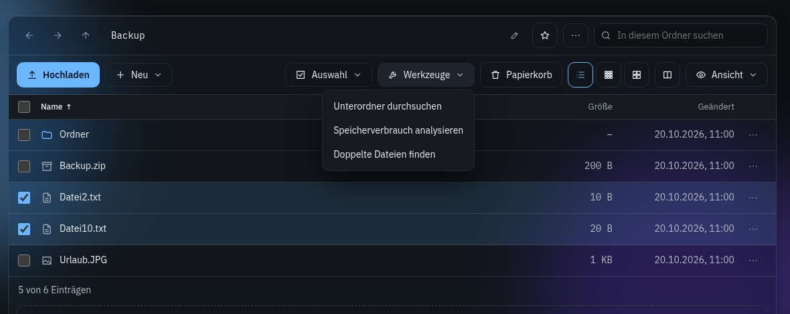
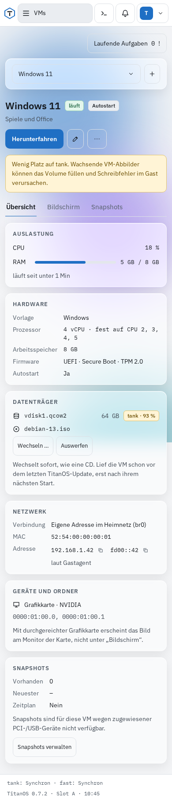
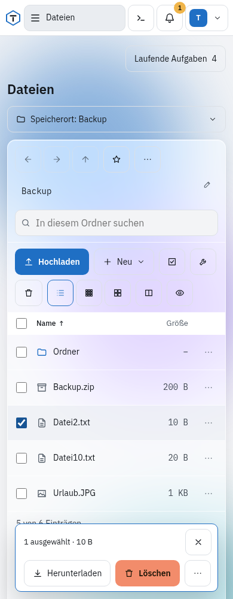

  <picture>
    <source media="(prefers-color-scheme: dark)" srcset="docs/brand/titanos-wordmark-dark-bg.svg">
    
  </picture>

<strong>Ein schlankes NAS-Betriebssystem, das vom USB-Stick bootet und komplett im RAM läuft.</strong>

---

> **Aktuelle Version: [TitanOS 0.9.0 Stable](https://github.com/ra5on/TitanOS/releases/tag/v0.9.0)** · Veröffentlicht am 21. Oktober 2026. Diese README beschreibt den Funktionsumfang dieser Version. Updates verwenden den gemeinsamen Stable-Kanal; einzelne optionale Funktionen sind als Beta gekennzeichnet.

  

Die Screenshots zeigen die Weboberfläche von **0.7.2** (VMs), **0.7.1** (Dateimanager) und **0.7.0** (Detailansichten) mit isolierten Beispieldaten, keine Messwerte eines produktiven NAS. Desktop: Graphit; Smartphone: Hell.

## Was TitanOS ist

TitanOS macht aus einem PC ein NAS. Das System liegt auf einem USB-Stick, wird beim Start komplett in den Arbeitsspeicher geladen und läuft von dort. Der Stick wird danach nur noch angefasst, wenn sich die Konfiguration ändert oder ein Update kommt. Bedient wird alles im Browser.

Die Idee ist von Unraid inspiriert, setzt aber auf klassisches RAID. TitanOS ist ein eigenständiges Projekt und steht in keiner Verbindung zu Lime Technology. Es basiert auf Debian 13 (trixie) für x86-64.

## Weboberfläche in 0.9.0

- **Eigene KI-Agenten (0.9.0):** Ein Agent, etwa mit einem Modell aus Ollama, liest mit einem API-Schlüssel über den eingebauten MCP-Server den Zustand des NAS: Volumes, Platten, Container, VMs, Backups, Meldungen und Protokolle. Ab Werk aus (Einstellungen › Zugang). Schlüssel mit Bereichen, Ablauf und erlaubten Netzen unter Mein Konto. Agenten ändern nichts. Als Beispiel gibt es die App „TitanOS-Agent“ mit Chat im Browser ([examples/agent](examples/agent), [docs/AGENT-API.md](docs/AGENT-API.md)).
- **Updates ohne Neustart (0.8.0):** Kleine Updates tauschen nur das Programm von TitanOS mit seiner Weboberfläche aus, ohne Neustart des NAS. Container, VMs und Freigaben laufen weiter, die Anmeldung bleibt. Eine neue Version läuft auf Probe; startet sie nicht, kehrt TitanOS von selbst zur vorigen zurück. Volle Updates mit Neustart bleiben für neue Systempakete und Kernel.
- **Neue VM-Seite (0.7.2):** Reiter Übersicht, Bildschirm und Snapshots; Übersicht in Kacheln mit Auslastung, Hardware, Datenträgern, Netzwerk und Geräten. CD einlegen, wechseln und auswerfen auch bei laufender VM, Adresse der VM über den QEMU-Gastagent oder die Nachbartabelle des NAS. Liste mit Filter und Aktionen je VM, aufgeräumte Bildschirm-Leiste mit „Senden“ und „Anzeige“.
- **Aufgeräumter Dateimanager (0.7.1):** zwei kompakte Leisten statt fünf, Pfadeingabe in den Brotkrumen, Sortieren über die Spaltenköpfe, schwebendes Kontextmenü (auch per Tastatur), Doppelklick für Vorschau und Editor, Symbole nach Dateityp und eine Aktionsleiste, die bei einer Auswahl am unteren Rand bleibt. Auf dem Smartphone ist die Ortsauswahl eingeklappt.
- **Persönlicher Dateimanager:** benannte und sortierbare Favoriten, Ansichten und Sortierung je Ordner im Benutzerkonto, Ordnerbaum, zwei Ansichten, Suche und schnelle Darstellung großer Ordner.
- **Sichere Dateiaktionen:** neue Text-/Markdown-/JSON-Dateien ohne Überschreiben, gezielte Auswahl nach Dateityp, Vorschau von Quelle, Ziel, Umfang und freiem Speicher vor Übertragungen. Ziehen zwischen Ansichten und einzelne Konfliktentscheidungen.
- **Papierkorb und Rückgängig:** sichtbarer Papierkorb mit Originalpfaden, Datumsfiltern und Speicherbelegung; Wiederherstellungsvorschau und Rückgängig für unterstützte Aktionen innerhalb der Dienstlaufzeit.
- **Vorschau und Werkzeuge:** Bilder, PDF, Audio/Video, Texteditor mit vorheriger Fassung und Zeilenvergleich. Unterordnersuche, Sammelumbenennen, ZIP-Inhalte, Ordnervergleich, Duplikatsuche und Speicheranalyse auf Anforderung.
- **Übertragungen im Blick:** Warteschlange, Pause, Priorität und Geschwindigkeitslimit, gemessener Fortschritt, geschätzte Restzeit und verständliche Fehler. Uploads mit gemeinsamer Pause-/Fortsetzen-/Wiederholen-Steuerung.
- **Namen und Updates:** Schreibweise benutzergewählter Volume-/Backup-Namen bleibt erhalten. Nach der Besitzer-/Administrator-Anmeldung läuft eine signierte Updateprüfung im Hintergrund; Meldungen führen zur Update-Seite.
- **Bestehende Oberfläche:** Einstellungen, Sicherungsübersicht, Themes und mobile Ansichten bleiben erhalten. Die Docker-Oberfläche ist gegenüber 0.5.9 unverändert.

Alle Änderungen: [0.9.0](https://github.com/ra5on/TitanOS/releases/tag/v0.9.0) · [0.8.0](https://github.com/ra5on/TitanOS/releases/tag/v0.8.0) · [0.7.2](https://github.com/ra5on/TitanOS/releases/tag/v0.7.2) · [0.7.1](https://github.com/ra5on/TitanOS/releases/tag/v0.7.1) · [0.7.0](https://github.com/ra5on/TitanOS/releases/tag/v0.7.0) · [0.6.1](https://github.com/ra5on/TitanOS/releases/tag/v0.6.1).

## Funktionen

- **Start vom Stick, Betrieb im RAM.** Das komprimierte Systemabbild wird beim Booten in den Arbeitsspeicher kopiert, darüber liegt eine auf 512 MB begrenzte Schreibschicht. Container, VM-Abbilder und Nutzdaten liegen auf Daten-Volumes. Größe und RAM-Bedarf hängen vom Release und den laufenden Diensten ab.
- **Konfiguration auf dem Stick.** Systemeinstellungen, Konten und Schlüssel liegen im Ordner `config` auf dem Stick. Der Stick wird bei Bedarf eingebunden und nach 30 Sekunden ohne Zugriff wieder ausgehängt. Eine automatische Sicherung auf einem Daten-Volume ermöglicht die Wiederherstellung nach einem Stick-Ausfall; die aktive Konfiguration bleibt auf dem Stick.
- **Ersteinrichtung und Anmeldung.** Beim ersten Start legst du das Besitzerkonto mit frei gewähltem Namen an; ein kurzer Assistent fragt danach Name und Zeitzone ab. Es gibt kein festes „admin“ und keinen Login als root. Wiederholte Fehlversuche werden ausgebremst, und jedes Konto lässt sich mit einem zweiten Faktor (Code aus einer Authenticator-App) schützen.
- **HTTPS von Anfang an.** Die Weboberfläche läuft über HTTPS mit einem selbst signierten Zertifikat, das über Neustarts gleich bleibt. Ein eigenes Zertifikat mit Schlüssel und Zertifikatskette lässt sich als PEM importieren und ohne Neustart verwenden.
- **Dashboard mit frei anordenbaren Kacheln.** Kacheln rasten in einem Raster aus 12 Spalten ein, lassen sich verschieben, in der Größe ändern und ausblenden. Das Layout wird pro Konto gespeichert.
- **Darstellung nach Wunsch.** Themes, Akzentfarben, Glas-Effekt, Eckenradius, Schriftgröße, Dichte und Hintergrund, mit Vorschau und Export als Datei.
- **Klassisches RAID.** Volumes mit RAID 0, 1, 5, 6 und 10 über Linux-Software-RAID (mdadm) mit ext4 oder XFS. Fällt eine Platte aus, lässt sie sich in der Oberfläche entfernen und ersetzen; Wiederaufbau und Prüfung zeigen ihren Fortschritt.
- **Freigaben.** SMB mit Rechten pro Konto, Gastzugriff nur lesend, Papierkorb und Time-Machine-Ziel; NFS für ausgewählte Rechner. Dazu fertige Adressen zum Verbinden.
- **Dateimanager im Browser.** Dateien und ganze Ordner hochladen, herunterladen (auch als ZIP), erstellen, kopieren, verschieben, umbenennen und in den Papierkorb oder endgültig löschen. Vorschauen, persönliche Ordneransichten und Werkzeuge sind oben beschrieben; Rechte des angemeldeten Kontos gelten bei jeder Aktion.
- **Docker.** Die Engine speichert alles auf einem Volume deiner Wahl. Die Übersicht zeigt Container und Stacks mit CPU, RAM, Ports und Update-Hinweisen, dazu Start, Stopp, Logs und eine Konsole im Browser. Jede App lässt sich als Formular oder als Compose-Datei bearbeiten.
- **App-Store.** Der separate [TitanOS-App-Store](https://github.com/ra5on/TitanOS-Apps), eingebaute Vorlagen und eigene Quellen (Repository, Archiv oder Compose-Datei), darunter CasaOS-kompatible Stores mit mehreren hundert Apps. Beim Installieren füllt TitanOS Zeitzone, Pfade, freie Ports und Geheimnisse selbst aus und zeigt bei jedem Feld, woher der Wert kommt.
- **Virtuelle Maschinen.** KVM/QEMU mit UEFI: VMs anlegen, starten und stoppen, mit dem Bildschirm der VM direkt im Browser und einer Übersicht samt Adresse im Netz; CDs lassen sich im laufenden Betrieb wechseln. Kerne festlegen, vorhandene Abbilder und ganze Platten nutzen, Grafikkarten und USB-Geräte durchreichen, NAS-Ordner in der VM einbinden, TPM 2.0 und Secure Boot.
- **Netzwerk.** Feste Adresse, Bonding, VLAN und eine Bridge, über die VMs eine eigene Adresse im Heimnetz bekommen. Jede Änderung gilt erst auf Probe: Ohne Bestätigung innerhalb von zwei Minuten kehrt das NAS zur alten Einstellung zurück.
- **Benachrichtigungen.** Fällt eine Platte aus, läuft ein Wiederaufbau oder wird ein Volume voll, steht das in der Weboberfläche und kommt auf Wunsch per E-Mail, ntfy, Telegram oder Discord.
- **Backups.** Freigaben mit restic verschlüsselt auf ein anderes Volume, einen anderen Server (SFTP), S3-Speicher oder einen restic-REST-Server sichern, nach Zeitplan und mit Ständen der letzten Tage, Wochen und Monate; Wiederherstellen in einen eigenen Ordner. Externe S3- und REST-Dienste müssen mit dem jeweiligen Ziel geprüft werden.
- **Kopie-Backups.** Freigaben auf externe USB-Platten oder ein SMB-Ziel kopieren, sofort oder nach Zeitplan. Neue und geänderte Dateien werden übertragen; gelöschte Quelldateien bleiben am Ziel. Die Kopien sind direkt lesbar, ohne Versionierung. SMB-Ordnerkopie ist als Beta gekennzeichnet. [USB-Kopie](docs/USB-COPY-BACKUPS.md) · [SMB-Kopie](docs/SMB-COPY-BACKUPS.md).
- **USV.** Per USB oder über das Netzwerk; bei Stromausfall fährt das NAS sauber herunter, bevor die Batterie leer ist, und kann den Zustand der USV an andere Geräte weitergeben.
- **Updates mit Rückfall.** Der Stick hält zwei Systeme. Eine neue Version kommt in das, das gerade nicht läuft, und startet auf Probe; kommt sie nicht hoch, startet das NAS von selbst wieder die vorherige. Kleine Updates ersetzen nur das Programm von TitanOS und kommen ohne Neustart, ebenfalls auf Probe. Installiert wird nur, was mit dem Schlüssel des Projekts signiert ist.
- **Sicherung des Sticks.** Automatische Sicherung der Konfiguration auf ein verfügbares Volume, gebündelt nach Änderungen; zusätzlich Download und Wiederherstellung. Beim Ersatz eines Sticks lässt sich eine gefundene Sicherung in der Ersteinrichtung auswählen und zurückspielen.
- **Platten vorbereiten.** Neue Platten lassen sich vor dem Einbau prüfen: ganz lesen oder überschreiben und zurücklesen, danach der lange Selbsttest der Platte.
- **Protokoll und Diagnosepaket.** Die Meldungen des Systems im Browser, nach Quelle und Stufe gefiltert. Für Fehlerberichte packt TitanOS Protokolle und Systemzustand in eine Zip-Datei und filtert bekannte Adress-, Namens- und Geheimnisfelder. Das Paket vor dem Weitergeben prüfen; die Filter können unbekannte Formate übersehen.
- **Plugins.** Systemerweiterungen für Treiber und Werkzeuge, die auf einem Volume liegen und sich ein- und ausschalten lassen. Das NVIDIA-Plugin wird separat mit passendem Kernel und signiertem Manifest ausgeliefert; siehe [Anleitung](docs/NVIDIA.md).
- **Terminal.** Eine Shell auf dem NAS und Konsolen in Containern als Tabs am unteren Rand jeder Seite – nur für Besitzer und Administratoren. Die NAS-Shell verwendet die bestehende Anmeldung; Gastkonsolen haben eigene Bestätigungsregeln.
- **SSH und eigenes Zertifikat.** SSH ist ab Werk aus; eingeschaltet melden sich Administratoren mit Schlüssel unter ihrem eigenen Namen an, nie als root. Die Weboberfläche nimmt ein eigenes Zertifikat an.
- **Konten mit Rollen.** Besitzer, Administratoren und Benutzer; jedes Konto gilt für die Weboberfläche und für SMB.
- **Deutsch und Englisch.**

## Einblicke in die Oberfläche

<table>
<tr><td width="50%"></td><td width="50%"></td></tr>
<tr><td align="center">Übertragung prüfen</td><td align="center">Papierkorb</td></tr>
<tr><td></td><td></td></tr>
<tr><td align="center">Textvergleich</td><td align="center">Zwei Ordner</td></tr>
</table>

 

## Speicher und Hardware

- **Btrfs-Spiegel:** native RAID1-Spiegel aus genau zwei Platten, schreibgeschützte Snapshots, Wiederherstellung in einen neuen Ordner, Scrub und Ersatz eines fehlenden Mitglieds. [Btrfs-Anleitung](docs/BTRFS.md).
- **Geräteauswahl für Container:** iGPU/GPU, NPU, NVIDIA und Coral USB im App-Installationsdialog und Container-Editor; gespeichert werden stabile Gerätekennungen. [Hardware und Plugins](docs/PLUGINS.md).
- **Weitere Plugins:** Intel GPU Tools aus Debian und Coral-USB-Erkennung mit Diagnose. Die Coral-Laufzeit bringt die jeweilige Container-App mit; PCIe/M.2-Coral wird nicht unterstützt.
- **Plugins direkt von GitHub:** Die Plugin-Seite zeigt den signierten Katalog des laufenden Releases. Pakete werden erst beim Installieren auf das Daten-Volume geladen und vor der Aktivierung geprüft. Die manuelle Installation aus einer Freigabe bleibt möglich. [Plugin-Installation](docs/PLUGINS.md#installation-der-zusätzlichen-plugins).
- **NVIDIA:** Leistungslimit innerhalb der Kartengrenzen und optionaler Wechsel zwischen VM und zuvor laufenden GPU-Containern. [Bedienung und Grenzen](docs/PLUGINS.md#nvidia-zwischen-vm-und-containern).
- **Plugins bei Systemupdates:** signierte passende Versionen werden vor dem Slot-Wechsel vorbereitet. Dateien und Aktivierungseinstellungen bleiben je Systemversion getrennt, damit ein Rollback seine ursprünglichen Plugins erhält.

## Weitere Funktionen

- Getrennte CPU-/RAM-/Systemkacheln, kleinere VM-/Containerkacheln und Einstellungen für Kachelbreite, Höhe und Zusatzwerte; IPv6 im Netzwerk-Dashboard. [Monitoring](docs/MONITORING.md).
- Einstellungen für den physischen [Ein-/Ausschalter](docs/POWER-BUTTON.md).
- Fernzugriff über das [Tailscale-Plugin](docs/TAILSCALE.md) mit Subnet-Routing und beiden Exit-Node-Rollen.
- Öffentliche [NVIDIA-Treiber auf dem NAS vorbereiten](docs/NVIDIA-LOCAL-BUILD.md), anschließend ausdrücklich beim Neustart aktivieren.

### VM-Firmware

Beim Anlegen einer VM kann zwischen **UEFI (OVMF)** und **Legacy-BIOS (SeaBIOS)**
gewählt werden. UEFI bleibt Standard; vorhandene VMs behalten UEFI. Die Auswahl
ist nach dem Anlegen fest, da sie zum installierten Gast passen muss. Für
Windows 11 UEFI mit TPM und Secure Boot verwenden. TitanOS selbst benötigt
weiterhin UEFI zum Starten.

### Dateien bearbeiten und externe USB-Laufwerke

Gängige UTF-8-Textdateien bis 512 KiB lassen sich direkt unter
**Dateien → Bearbeiten** speichern, auch JSON/YAML auf beschreibbaren Freigaben,
Volumes und USB-Geräten. Uploads auf externe exFAT-Laufwerke werden unterstützt.
[Bedienung, Dateiformate und Grenzen](docs/FILE-EDITOR.md).

### Windows meldet einen zu langen Zielpfad

Bei tiefen Ordnerbäumen gelten zusätzlich Grenzen des Windows-Kopierprogramms.
Siehe [Kopieren langer Pfade über SMB](docs/WINDOWS-SMB.md) für Robocopy und die
Unterscheidung zwischen Gesamtpfad und einzelnem Dateinamen.

## Voraussetzungen und Prüfstand

- PC mit x86-64-Prozessor und UEFI; Secure Boot für das NAS ausgeschaltet. Legacy-BIOS und ARM werden nicht unterstützt. Secure Boot innerhalb einer VM ist davon unabhängig.
- Für erste Tests 4 GB RAM einplanen, zusätzlich RAM für Container und VMs. Das ist eine Testempfehlung, keine auf echter Hardware geprüfte Mindestanforderung.
- USB-Stick mit 8–32 GB, FAT32 und Label `TITANOS`; separate Datenplatten. Anlegen eines Volumes löscht die ausgewählten Platten. RAID ersetzt kein Backup.
- Kabelgebundenes Netzwerk; zunächst DHCP. Netzwerkänderungen sind anschließend in der Weboberfläche möglich. Firmware für ausgewählte Realtek-/Broadcom-Netzwerkkarten, QLogic-Adapter sowie Intel- und AMD-Grafik ist enthalten, einschließlich Intel GuC/HuC und NPU-Firmware. Unterstützung hängt zusätzlich vom Debian-Kernel und dem konkreten Gerät ab.
- Der Prüfstand deckt nicht jede USV, jedes externe Backupziel oder jede GPU ab. Die verfügbaren Hardwareberichte ersetzen keine Prüfung der eigenen Geräte und Rücksicherung. TitanOS im vertrauenswürdigen lokalen Netz betreiben.
- Volume-Verschlüsselung, Bootloader-Aktualisierung und Systemupdates aus einer hochgeladenen Datei sind nicht enthalten. HTTPS unterstützt selbst signierte und importierte Zertifikate; eine automatische Let’s-Encrypt-Verwaltung ist nicht enthalten.

## Installation

Die Dateien für **0.9.0** stehen auf der [Release-Seite](https://github.com/ra5on/TitanOS/releases/tag/v0.9.0). Für einen neuen Stick:

1. `titanos-0.9.0.zip`, `titanos-0.9.0.zip.minisig` und `titanos-0.9.0.zip.sha256` laden. Signatur mit [minisign](https://jedisct1.github.io/minisign/) und einem vertrauenswürdig bezogenen öffentlichen [Release-Schlüssel](build/mkosi.extra/usr/share/titanos/update-keys/) prüfen; der Prüfablauf steht in [RELEASING.md](docs/RELEASING.md#downloads-prüfen). Die Prüfsumme allein bestätigt nicht die Herkunft.
2. Einen leeren USB-Stick als FAT32 mit dem Label `TITANOS` formatieren. Das ZIP direkt ins Stammverzeichnis entpacken: Dort müssen `EFI`, `loader`, `titanos` und `config` liegen, ohne zusätzlichen Unterordner.
3. Das NAS vom Stick starten (UEFI, Secure Boot aus). Die per DHCP vergebene IP steht auf der Konsole oder im Router. Im Browser `https://<nas-ip>` öffnen; das selbst signierte Zertifikat verursacht zunächst eine Browserwarnung.
4. Bei einem Ersatzstick zuerst die angebotene Konfigurationssicherung wiederherstellen (siehe unten). Bei einer Neuinstallation: Besitzerkonto anlegen, Sprache, Hostname und Zeitzone einstellen. Danach unter „Speicher“ ein Volume anlegen und unter „Shares“ eine Freigabe einrichten. Konfigurationssicherung und gegebenenfalls 2FA einrichten.

Updates werden unter **Einstellungen › Updates** angeboten. TitanOS verwendet den Stable-Kanal; frühere Beta-Kanaleinstellungen werden automatisch umgestellt. Für ein Update einer vorhandenen Installation die Update-Seite verwenden; den Stick mit bestehender Konfiguration nicht neu formatieren.

## USB-Stick ersetzen und Volumes weiterverwenden

Die aktive Konfiguration liegt auf dem Bootstick. TitanOS sichert sie standardmäßig automatisch auf ein verfügbares Daten-Volume unter `.titanos/backups/`. Die Sicherung enthält unter anderem Konten, Freigaben und die UUID-Zuordnung der Volumes; sie ersetzt kein Backup der Nutzdaten.

Nach einem Stick-Ausfall einen neuen Stick vorbereiten und beim ersten Start **vor dem Anlegen eines neuen Kontos** die gefundene Konfigurationssicherung auswählen. TitanOS sucht dafür auf vorhandenen unterstützten Volumes lesend nach Sicherungen. Nach Wiederherstellung und Neustart werden die registrierten Volumes wieder eingebunden. Die vorhandenen Datenplatten dabei nicht als neue Volumes anlegen oder formatieren.

Ohne Konfigurationssicherung bleiben die Daten erhalten, ein geführter Import beliebiger vorhandener Volumes ist nicht enthalten.

## Tests und Funktionsstatus

Die automatisierten Prüfungen umfassen Backend und WebUI, signierte Release-Dateien, virtuelle UEFI-Starts und Update-/Rollback-Abläufe. Funktionen wie RAID, Btrfs, Plugins und VM-Snapshots haben zusätzliche Tests in isolierten virtuellen NAS-Systemen.

Für **0.9.0** wurden Frontend- und Backend-Tests ausgeführt, dazu Tests für API-Schlüssel und MCP-Endpunkt über HTTP und für den Beispiel-Agenten gegen nachgebaute Server. Seit 0.8.0 spielt ein QEMU-Test ein App-Update ohne Neustart, eine App, die nicht startet, und den Rückweg durch. Die Release-Pipeline baut und prüft das bootfähige ZIP und die Plugins vor der Veröffentlichung in QEMU. Browserprüfungen verwenden isolierte Testdaten und decken unter anderem Suche, direkte Links, Fehler/Wiederholung, Kontorollen und mobile Ansichten ab. Das ist keine vollständige Hardware-Abnahme. Der öffentliche Update- und Rückwechselpfad **0.5.9 → 0.6.0 → 0.5.9** wurde in QEMU mit erhaltenem Besitzerkonto, Zertifikat und Zeitzone geprüft.

Optionale Funktionen wie die SMB-Ordnerkopie tragen ein eigenes Beta-Label. Das Label beschreibt die Funktion, keinen zweiten Updatekanal.

## Entwicklung

Voraussetzungen: Go 1.27+, Node.js 24+, Python 3.11+ und `make`.
Für das Systemabbild zusätzlich (Debian 13): mkosi **25.3**, `debian-archive-keyring squashfs-tools zstd zip systemd-container`. Für Release-Tests außerdem `minisign`; für den NVIDIA-Plugin-Bau `kmod`, Netzwerkzugang und einen isolierten Debian-Build als root bzw. in einem Benutzer-Namespace; für den QEMU-Test `qemu-system-x86 ovmf mtools fdisk`. Unprivilegierte Builds benötigen funktionierende Benutzer-Namespaces, `newuidmap`/`newgidmap` und Einträge in `/etc/subuid` und `/etc/subgid`. Alternativ baut `MKOSI_SUDO=1 make zip` das Abbild mit sudo; Weboberfläche und Backend werden weiterhin als normaler Benutzer gebaut.

| Befehl | Was er tut |
|---|---|
| `make build` | Baut die Weboberfläche und `backend/bin/titand` mit eingebetteter Oberfläche |
| `make test` | Führt die Go-Tests und die Typprüfung der Weboberfläche aus |
| `make test-release` | Prüft Verpackung, Lizenzinventar und Manipulationserkennung mit kleinen echten squashfs-Abbildern und Minisign-Schlüsseln |
| `make dev` | Startet `titand` im Entwicklungsmodus auf `127.0.0.1:8080` (ohne HTTPS, Konfiguration in `test/config/`) und den Vite-Server mit automatischem Neuladen |
| `make zip` | Baut das Systemabbild und packt den Stick-Inhalt: `out/stick/` und `out/titanos-<version>.zip` |
| `make zip-dev` | Dasselbe als Entwicklungsvariante, bei der root an der Konsole automatisch angemeldet ist |
| `make qemu` | Startet `out/stick/` in QEMU (UEFI) von einem emulierten USB-Stick; Weboberfläche unter `https://127.0.0.1:8443`. Mit `DISKS=4 make qemu` kommen vier leere Testplatten dazu. |

Das Backend (`backend/`, Go) und die Weboberfläche (`web/`, Svelte + TypeScript) liegen in diesem Repository. In `backend/` funktionieren `go build ./cmd/titand` und `go test ./...` ohne Node.js; ohne das Build-Tag `embedui` wird eine Platzhalterseite statt der Weboberfläche ausgeliefert. Release-Bau und Signierung sind in [RELEASING.md](docs/RELEASING.md) beschrieben.

## Lizenz

TitanOS ist **Fair Source** unter der [Functional Source License 1.1 (FSL-1.1-ALv2)](LICENSE.md):

- Nutzen, Ändern und Weitergeben ist frei – privat, im Unternehmen, für Lehre und Forschung.
- Nicht erlaubt: TitanOS oder ein wesentlich darauf beruhendes Produkt als konkurrierendes kommerzielles Produkt oder als Dienst anzubieten.
- Jede Version steht zwei Jahre nach ihrem Erscheinen unter der **Apache License 2.0**.

Maßgeblich ist der Lizenztext in [LICENSE.md](LICENSE.md). Fremdkomponenten (Linux-Kernel, Debian-Pakete und andere) behalten ihre eigenen Lizenzen, siehe [THIRD_PARTY_LICENSES](THIRD_PARTY_LICENSES).

## Mitmachen

Beiträge sind willkommen – bitte lies zuerst [CONTRIBUTING.md](CONTRIBUTING.md) (auf Englisch). Sicherheitslücken bitte nicht öffentlich melden, sondern wie in [SECURITY.md](SECURITY.md) beschrieben.
