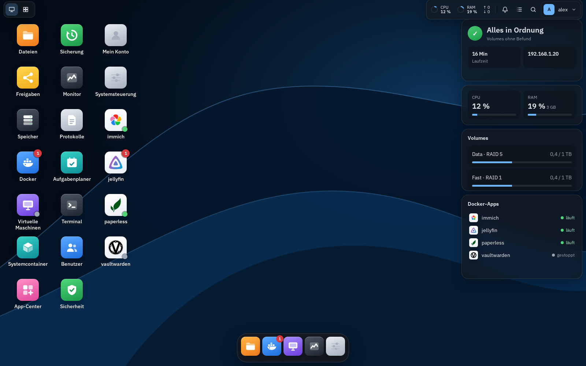
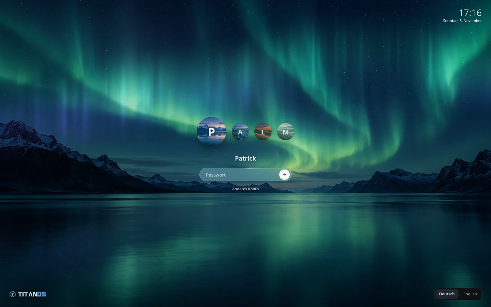
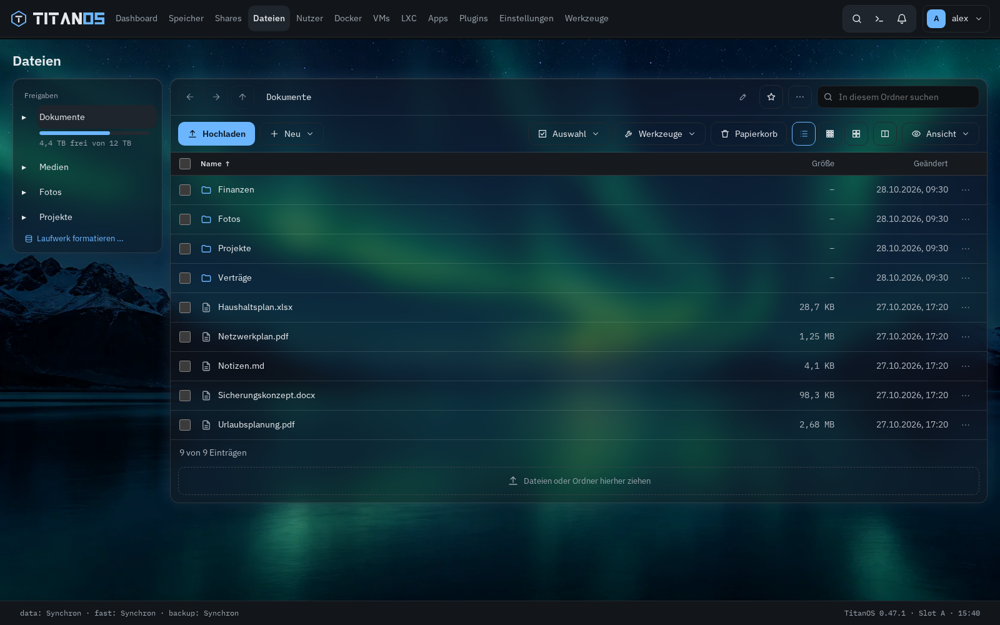
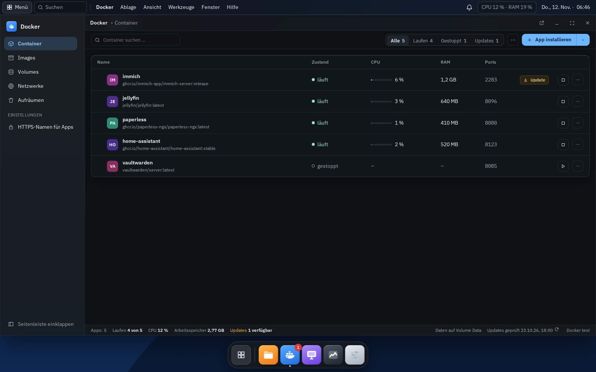
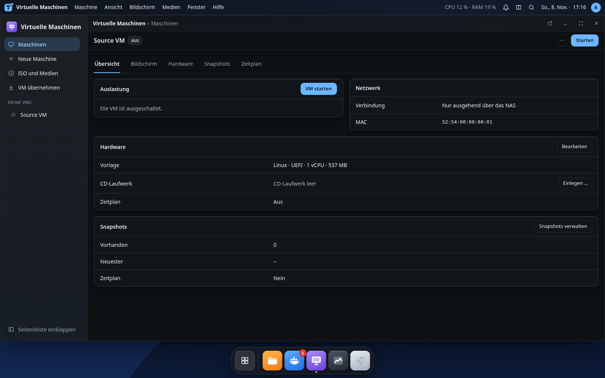
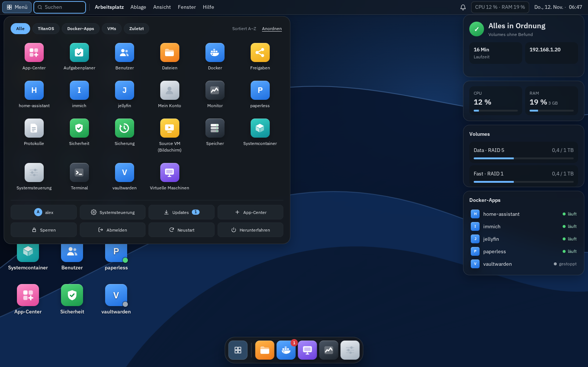
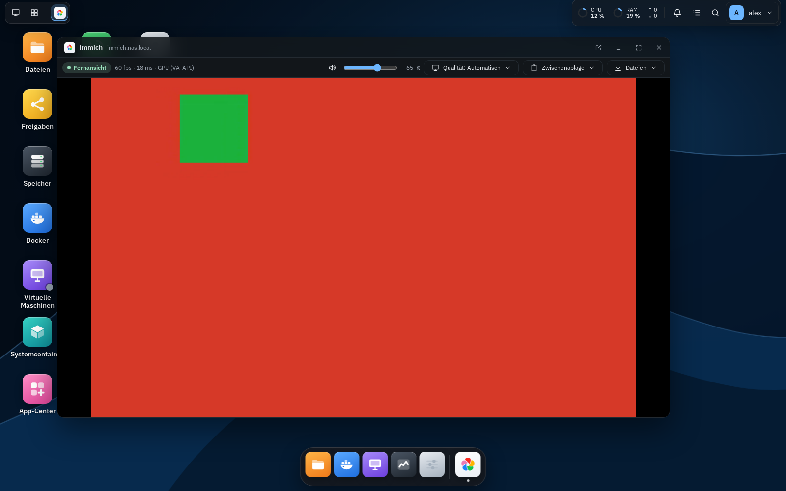
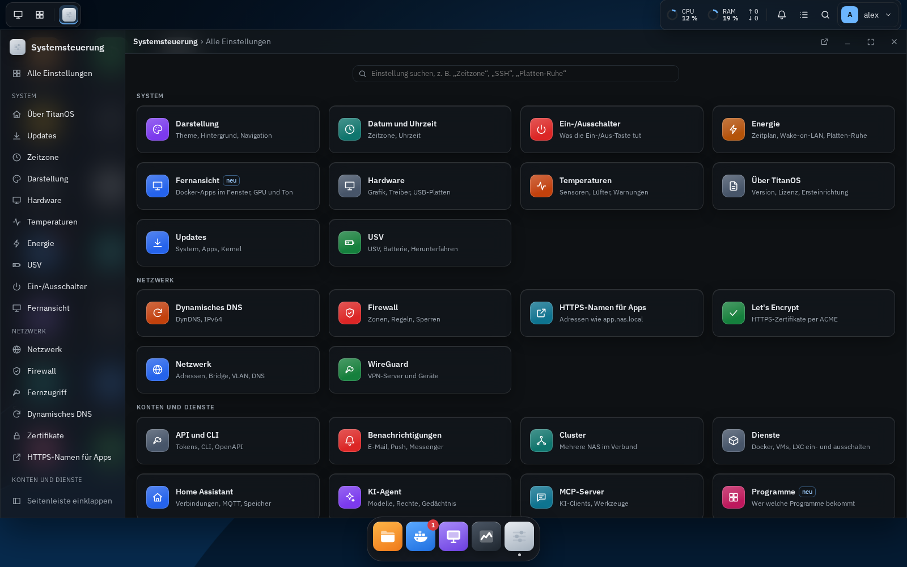
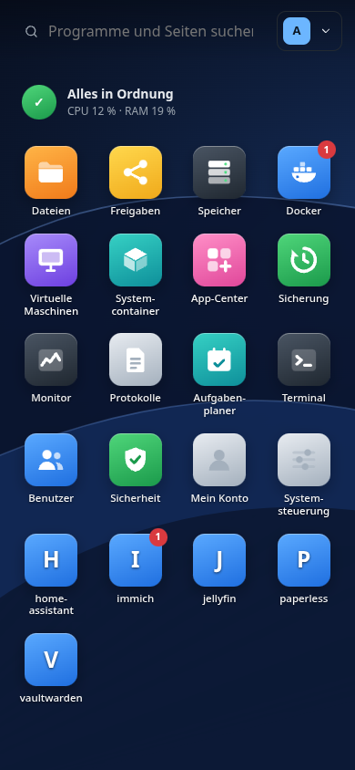
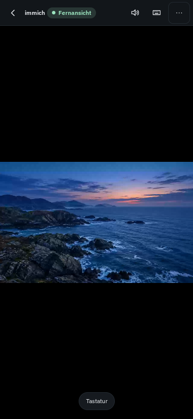

  

  <a href="#installation">Installation</a> ·
  <a href="#funktionen">Funktionen</a> ·
  <a href="#dokumentation">Dokumentation</a> ·
  <a href="LICENSE.md">Fair Source</a>

 

  <picture>
    <source media="(prefers-color-scheme: dark)" srcset="docs/readme/h-intro-dark.svg">
    
  </picture>

Fenster, Dock, Arbeitsplatz. Im Browser, auf jedem Gerät. Startet vom USB-Stick. Läuft komplett im Arbeitsspeicher.

<table>
<tr>
<td width="58%"></td>
<td>ANMELDUNG<h3>Nordlicht inklusive.</h3>Ein bewegter Himmel. Dein Bild im Kreis. Ein Feld fürs Passwort – und du bist da.  Passkey · Zwei-Faktor · Bewegung abschaltbar</td>
</tr>
<tr>
<td>DATEIEN<h3>Vertraut vom ersten Klick.</h3>Adresszeile, Befehlsleiste, Mehrfachauswahl. Suche bis in den Inhalt deiner Dokumente.  SMB · NFS · WebDAV · USB</td>
<td width="58%"></td>
</tr>
<tr>
<td width="58%"></td>
<td>APPS<h3>Installiert. Läuft.</h3>Immich, Jellyfin, Home Assistant und mehr aus dem App-Store. Jede App im eigenen Fenster. Auch unterwegs.  Compose · Updates · Startreihenfolge</td>
</tr>
<tr>
<td>VIRTUELLE MASCHINEN<h3>Ein Rechner im Rechner.</h3>Windows, Linux, Home Assistant OS. Bildschirm im Browser, Snapshots, durchgereichte Grafikkarte.  KVM/QEMU · GPU · USB</td>
<td width="58%"></td>
</tr>
</table>

 

  <picture>
    <source media="(prefers-color-scheme: dark)" srcset="docs/readme/h-alles-dark.svg">
    
  </picture>

<table>
<tr>
<td width="33%"><b>Speicher</b> RAID 0, 1, 5, 6, 10. Btrfs-Spiegel. SSD-Cache. Verschlüsselung.</td>
<td width="33%"><b>Sicherheit</b> Signierte Updates mit Rückfall. Firewall. Zwei-Faktor. Passkeys.</td>
<td width="33%"><b>KI-Agent</b> Dein eigenes Ollama. Feste Rechte. MCP für Claude.</td>
</tr>
<tr>
<td><b>Sicherung</b> Versioniert. Auf USB, SMB oder ein zweites NAS. Mit Prüfung.</td>
<td><b>Fernzugriff</b> Tailscale, NetBird, WireGuard. Let's Encrypt.</td>
<td><b>Handy</b> App-Raster. Jedes Programm im Vollbild.</td>
</tr>
</table>

Alle Bilder zeigen die echte Oberfläche mit Beispieldaten. Keine Mockups. <a href="docs/screenshots/README.md">Aufnahmestand</a>.

TitanOS basiert auf **Debian 13** und läuft auf jedem 64-Bit-PC (x86-64) und startet von einem USB-Stick, normal per UEFI. Ältere Rechner mit 32-Bit-UEFI-Firmware oder Legacy-BIOS starten ebenfalls; das System bleibt auch dort 64-Bit. Daten, Apps und VMs liegen auf eigenen Volumes, die Konfiguration bleibt auf dem Stick. Die Bedienidee ist von Unraid inspiriert. TitanOS setzt auf klassisches Linux-Software-RAID und ist ein eigenständiges Projekt ohne Verbindung zu Lime Technology.

## Funktionen

Alles im Einzelnen – zum Aufklappen.

<b>Arbeitsplatz, Fenster und Dock</b>

- **Jeder Bereich ein Programm:** Dateien, Freigaben, Speicher, Docker, Virtuelle Maschinen, Systemcontainer, App-Center, Sicherung, KI-Agent, Monitor, Protokolle, Aufgabenplaner, Terminal, Benutzer, Sicherheit, Mein Konto und Systemsteuerung öffnen als eigene Fenster. Jedes Fenster hat seine eigene, einklappbare Seitenleiste mit den Seiten und Einstellungen des Programms, die Titelleiste nennt Programm und Seite, die Aktionen stehen in einer Werkzeugleiste darunter.
- **Fenster wie am PC:** frei verschieben, an allen Kanten und Ecken vergrößern, an den Rand ziehen für die halbe Seite, nach oben für Vollbild, in die Ecke für ein Viertel – mit Vorschau. Knöpfe rechts: in eigenem Tab öffnen, minimieren, maximieren, schließen. Fensterwechsler und Tastenkürzel (Alt + Q, Alt + Pfeile, Alt + W, Strg + Leertaste). Die Browser-Adresse zeigt das Fenster vorn, Lesezeichen öffnen das passende Programm. Fenster-Anordnungen lassen sich speichern.
- **Arbeitsplatz:** Programmsymbole frei auf einem unsichtbaren Raster, „Automatisch anordnen“, drei Größen, Ordner, Abzeichen für Updates, Warnungen und „läuft/gestoppt“. Die Symbole behalten ihre Plätze, auch wenn das Browserfenster kleiner und wieder größer wird. Rechtsklick-Menüs auf Symbole, Arbeitsplatz, Widgets, Leisten und Dock.
- **Widgets** frei platzierbar und in der Größe änderbar: Zustand, CPU/RAM, Netzwerk, Volumes, Docker-Apps, VMs, Sicherungen, Temperaturen, Uhr, Home Assistant, Aufgaben sowie iGPU, NPU und Grafikkarte (nur was das Gerät meldet); einzeln entfernen oder alle ausblenden. Sie lesen nur, was die Oberfläche ohnehin abfragt, und wecken keine Platten.
- **Ein Menü** oben links (und im Dock) mit Filtern (TitanOS, Docker-Apps, VMs, Zuletzt), Programmen A–Z oder in eigener Reihenfolge und Konto, Systemsteuerung, Updates, App-Center, Sperren, Abmelden, Neustart, Herunterfahren; die Suche über Programme und ihre Seiten sitzt daneben in der Leiste. Programme aus dem Menü auf den Arbeitsplatz oder ins Dock ziehen.
- **Dock** (ab Werk an): angeheftete Programme und offene Fenster, Vergrößern beim Überfahren, umsortieren per Ziehen; Größe, Deckkraft, Vergrößern, Position (unten, links, rechts) und Umrandung im Rechtsklick oder unter Systemsteuerung › Darstellung › Dock mit Vorschau.
- **Leiste oben:** Menü und Suche, die Menüs des Programms vorn, im Cluster der Umschalter zwischen den Nodes, Aufgaben, Mitteilungen, CPU/RAM (abschaltbar) und Datum; Größe Klein/Mittel/Groß.
- **Sperrbildschirm und Anmeldung:** Sperren im Menü oder automatisch nach einstellbarer Zeit; Entsperren mit Passwort (und 2FA) oder Passkey. Die Anmeldeseite zeigt das bewegte Nordlicht, Kontobilder (eigenes Foto oder mitgeliefertes Bild) und auf Wunsch einen Übergang in den Arbeitsplatz.
- **KI-Agent** als eigenes Programm mit Chatfenster und eigenen Einstellungen, dazu eine Helfer-Blase, deren Frage mit dem Fenster vorn beginnt.
- **Dateien hineinziehen:** Dateien vom PC auf den Arbeitsplatz ziehen öffnet „Dateien“ und lädt sie in den offenen Ordner hoch.
- **Am Handy:** Startbildschirm mit Suche und App-Raster; jedes Programm und jede Docker-App öffnet im Vollbild mit „Zurück“. Ränder für Notch und Home-Leiste, keine vergrößernden Eingabefelder in Safari.
- **Klare Rückfragen statt Eintippen:** Löschen, Überschreiben, Plattentests, Zwei-Faktor-Zurücksetzen, SSH-Schlüssel und Zertifikate entfernen bestätigt man in einem Dialog, der genau nennt, was passiert. Namen müssen nirgends eingetippt werden; „Abbrechen“ hat den Fokus, Enter löst nie die gefährliche Aktion aus. Zerstörende Knöpfe stehen gesammelt in einer abgesetzten „Gefahrenzone“ am Ende. Fachbegriffe erklärt ein „?“ direkt daneben.

[Dock bearbeiten](docs/screenshots/current/dock-bearbeiten.png) · [Beschreibung des Desktop-Modus](docs/DESKTOP.md) · [Sperrbildschirm](docs/SESSION-LOCK.md)

<b>Speicher und Laufwerke</b>

- **Klassisches RAID:** mdadm mit RAID 0, 1, 5, 6 und 10; Dateisysteme ext4 und XFS. Volumes anlegen, Zustand und Belegung sehen, Mitglieder ersetzen und Wiederaufbau oder Konsistenzprüfung verfolgen.
- **Btrfs-Volumes:** eine Platte, Spiegel (RAID 1) oder drei Kopien (RAID1C3), auch aus Platten unterschiedlicher Größe. Platten später hinzufügen oder entfernen und das Profil im laufenden Betrieb ändern. Schreibgeschützte Snapshots, Scrub und Plattenersatz. Fehlt beim Start ein Mitglied, wartet TitanOS 60 Sekunden auf langsam anlaufende Platten, bevor das Volume ohne Redundanz eingebunden und als solches gemeldet wird. Snapshot-Zeitpläne mit Aufbewahrung sowie Wiederherstellung ganzer Snapshots, Ordner oder einzelner Dateien.
- **Vorhandenen Speicher übernehmen:** lesende Vorschau unterstützter mdadm- und Btrfs-Volumes, danach Registrierung ohne Formatierung. RAID5/6 lässt sich um eine Platte erweitern; dafür ist ein separates Rettungs-Volume erforderlich. Hinzufügen, Erweitern und Ersetzen prüfen die gewählte Platte erneut und lassen fremde Arrays, LVM und eingebundene Dateisysteme auf anderen Platten unangetastet.
- **SSD-Cache:** eine SSD vor ein bestehendes RAID setzen, ohne Neuformatieren. Wahlweise nur als Lesecache (sicher, falls die SSD ausfällt) oder als Lese- und Schreibcache; ab Werk aus. [Einzelheiten](docs/SSD-CACHE.md).
- **Verschlüsselung (optional):** ein Volume beim Anlegen mit LUKS2 verschlüsseln, ab Werk aus. Nach jedem Start bleibt es gesperrt, bis jemand das Passwort in der Weboberfläche eingibt; erst dann starten Freigaben, Apps, VMs und Container darauf. Passwörter ändern oder ergänzen, sperren und Header-Sicherung herunterladen auf der Speicher-Seite. [Einzelheiten](docs/ENCRYPTION.md).
- **Platte tauschen:** ein Assistent führt durch den Tausch einer ausgefallenen, fehlenden oder alternden Platte; eine noch arbeitende Platte eines mdadm-Volumes wird im laufenden Betrieb kopiert, ohne dass das Volume seine Redundanz verliert. „Platte finden“ lässt die Aktivitätsanzeige flackern. [Einzelheiten](docs/DISK-SWAP.md).
- **Plattenzustand und Vorbereitung:** SMART, Temperatur, Betriebsstunden, Fehler und Verschleiß; neue Laufwerke vollständig lesen oder überschreiben und zurücklesen, anschließend einen langen Selbsttest ausführen. Ruhezustand der Festplatten als Standard und abweichend je Volume oder je Platte, mit „schläft seit“ bzw. „zuletzt geweckt“ je Platte; erreichbar auch unter Einstellungen › Energie. [Einzelheiten](docs/DISK-SLEEP.md).
- **Verbrauch verstehen:** kompakte Volume- und Laufwerkslisten mit Details auf Auswahl, Speicheranalyse auf Anforderung und optionale Kapazitätsprognosen aus gültigen Monitoring-Verläufen.

[Btrfs](docs/BTRFS.md) · [Übernahme, Erweiterung und Speicheranalyse](docs/WORKFLOWS.md)

<b>Freigaben und Konten</b>

- **SMB:** Rechte je Konto, lesender Gastzugriff, Papierkorb mit Aufbewahrung und Time-Machine-Ziele. **NFS:** getrennt von SMB abschalten, nur lesend oder lesend/schreibend für ausgewählte Clients freigeben.
- **WebDAV (optional):** Freigaben als Netzlaufwerk über HTTPS, etwa in der Dateien-App des iPhones, im Finder oder im Windows-Explorer, auch von unterwegs. Eigenes WebDAV-Passwort je Konto, dieselben Rechte wie bei SMB. [Einzelheiten](docs/WEBDAV.md).
- **Übersichtliche Shares:** suchen, filtern und sortieren; Details, Verbindungsadressen und Dateimanager direkt an der Freigabe öffnen.
- **Vorgängerversionen und Ransomware-Schutz:** Btrfs-Snapshots erscheinen in Windows unter „Vorgängerversionen“. Benennt ein Konto plötzlich viele Dateien wie Ransomware um, wird die Freigabe sofort schreibgeschützt und ein Snapshot angelegt. Geplante Snapshots lassen sich für eine Frist gegen Löschen sperren. [Einzelheiten](docs/SHARE-PROTECTION.md).
- **Besitzer, Administratoren und Benutzer:** das erste Besitzerkonto hat einen frei gewählten Namen. Benutzer sehen ihre freigegebenen Dateien; Systemverwaltung, Docker und VMs bleiben den Verwaltungsrollen vorbehalten.
- **Anmeldung und Sicherheit:** Passwortschutz gegen Durchprobieren, TOTP mit Wiederherstellungscodes, Übersicht angemeldeter Geräte und Abmelden einzelner oder aller anderen Sitzungen. Konten lassen sich sperren, ohne sie zu löschen; das wirkt auch für SMB, SSH und API-Tokens. [Konten sperren](docs/ACCOUNT-LOCK.md).

<b>Dateien direkt im Browser verwalten</b>

- **Wie der Explorer:** Adresszeile mit Pfad und Suche, Befehlsleiste, die sich bei schmalen Fenstern selbst zusammenschiebt, ein Klick wählt eine Datei, Häkchen erst bei Mehrfachauswahl, Statuszeile mit Auswahl und freiem Platz.
- **Persönlicher Arbeitsplatz:** Ordnerbaum, benannte und sortierbare Favoriten, Ansichten und Sortierung je Ordner, zwei Ordner nebeneinander und eine Pfadeingabe in den Brotkrumen.
- **Dateien und Ordner bearbeiten:** erstellen, hochladen, herunterladen, als ZIP laden, kopieren, verschieben, umbenennen und löschen. Ziehen zwischen Ansichten, Übertragungsvorschau und Entscheidungen bei Namenskonflikten.
- **Von Link herunterladen:** eine HTTP(S)-Adresse, etwa ein ISO-Abbild, lädt das NAS selbst als Hintergrundauftrag in den geöffneten Ordner: optionale SHA-256-Prüfung, Fortsetzen nach Verbindungsabbruch, nie Überschreiben. Benutzerkonten erreichen dabei nur Adressen im Internet.
- **Vorschau und Texteditor:** Bilder, PDF, Audio und Video ansehen; UTF-8-Textdateien bis 512 KiB bearbeiten, einschließlich Markdown, JSON und YAML. Vorige Fassung vergleichen und wiederherstellen.
- **Vorschaubilder und Fotoansicht:** das NAS erzeugt Miniaturen für JPEG, PNG, GIF, WebP, PDF (erste Seite) und Videos (mit ffmpeg) und legt sie auf dem jeweiligen Daten-Volume ab. Die Fotoansicht zeigt einen Ordner als Raster nach Aufnahmedatum (EXIF) und im Großbild mit Pfeiltasten und Wischen.
- **Volltextsuche (optional):** ein ab Werk ausgeschalteter Index je Volume findet Wörter in PDF-, Word-, Excel- und Textdateien, auf Wunsch auch in gescannten PDFs (OCR). Er arbeitet nur, während das Volume ohnehin benutzt wird oder zu einer gewählten Uhrzeit, und zeigt jedem Konto nur Treffer in seinen Freigaben.
- **Werkzeuge:** Unterordnersuche, Sammelumbenennen, ZIP-Inhalte, Ordnervergleich, gezielte Übernahme von Unterschieden, Duplikatsuche und Speicheranalyse auf Anforderung.
- **Papierkorb:** Originalpfad, Datum und Belegung sehen, filtern und vor der Wiederherstellung prüfen. Unterstützte Aktionen lassen sich innerhalb der Dienstlaufzeit rückgängig machen.
- **Übertragungen steuern:** Warteschlange, Pause, Priorität, Geschwindigkeitslimit, Fortschritt und Restzeitschätzung. Dauerhaft gespeicherte Kopier-/Verschiebeaufträge auf Daten-Volumes lassen sich nach einem Dienstneustart geprüft fortsetzen. Unfertige Uploads können nach erneuter Dateiauswahl fortgesetzt werden.
- **Große Kopieraufträge:** keine feste Datei- oder GB-Grenze pro Auftrag. Auf Daten-Volumes werden Plan und Wiederaufnahmestand stückweise in einer Datenbank gespeichert; Dateien und Metadaten benötigen ausreichend Zielplatz.
- **Weitere Datenträger:** nicht verwaltete USB-, SATA-, SAS- und NVMe-Dateisysteme ausdrücklich einbinden; FAT32, exFAT, NTFS, ext2/3/4, XFS und Btrfs. Bei NTFS steht zusätzlich ein lesender Ausweichweg bereit. Jede Aktion berücksichtigt Kontorechte und Schreibschutz.
- **Laufwerke formatieren und partitionieren:** ganze Platten außerhalb der Volumes neu formatieren oder im Partitionseditor Tabellen anlegen, Partitionen anlegen, löschen, formatieren, umbenennen und in direkt folgenden freien Platz vergrößern – mit erneuter Prüfung der Platte direkt vor dem Schreiben. [Partitionseditor](docs/PARTITIONS.md).

[Texteditor und USB-Dateisysteme](docs/FILE-EDITOR.md) · [Vorschaubilder und Volltextsuche](docs/FILE-SEARCH.md) · [Partitionseditor](docs/PARTITIONS.md) · [Von Link herunterladen](docs/FILE-DOWNLOADS.md) · [Kopieren und Verschieben](docs/FILE-COPY.md) · [RAM und Uploads](docs/MEMORY.md) · [Lange Windows-SMB-Pfade](docs/WINDOWS-SMB.md)

<b>Docker und App-Store</b>

- **Start nach dem Hochfahren:** Apps und VMs starten erst, wenn Volumes und Freigaben bereit sind, auf Wunsch in fester Reihenfolge mit Wartezeit je Eintrag.
- **Container und Compose-Stacks:** Images und Tags einzeln je Dienst bearbeiten, Store-Vorgaben und Digests erhalten; Start, Stopp, Neustart, Logs und Browserkonsole; CPU, RAM, Ports und geprüfte Updatezustände im Blick. Suche, Filter sowie anpassbare Reihenfolge und Ansicht.
- **Kompakte Kacheln:** jeder Container als gleich breite Kachel mit App-Symbol, CPU und RAM, so viele nebeneinander wie Platz ist; der farbige Streifen zeigt, ob er läuft. Ein Klick aufs Symbol öffnet das Menü des Containers.
- **Docker-Apps im Fenster (Fernansicht):** Jede App mit Weboberfläche ist ein eigenes Programm. Ihr Fenster zeigt die App in der Fernansicht: TitanOS öffnet sie auf dem NAS in einem abgeschotteten Browser-Container und überträgt Bild und Ton über die TitanOS-Adresse (WebSocket, H.264/Opus) – im Heimnetz, per VPN, über einen Cloudflare-Tunnel und am Handy. Anmeldungen in den Apps bleiben je Konto und App erhalten; Lautstärke, Qualität (30/60 Bilder je Sekunde), Zwischenablage, Hoch- und Herunterladen im Fenster; GPU-Kodierung per VA-API (Intel/AMD) oder NVENC (NVIDIA-Plugin), sonst Prozessor. Das Abbild der Fernansicht ist eine eigene signierte Release-Datei (Download etwa 320 MB bei der ersten Ansicht). Wer welche App nutzen darf, steht unter Benutzer › Programme. „In eigenem Tab öffnen“ bleibt als Ausweg. [Einzelheiten und Grenzen](docs/FERNANSICHT.md).
- **Anwendungen schnell öffnen:** eigene App-Icons und Links zur WebUI, zur Tailscale-Adresse und zur öffentlichen Adresse, direkt im Menü mit Zieladresse. Bei Stacks bestimmt ein Hauptdienst die gemeinsamen Links.
- **Automatische App-Updates (optional):** gewählte Apps holen neue Images in einem Zeitfenster; läuft eine App danach nicht richtig, kehrt TitanOS zu den vorigen Images zurück. [Einzelheiten](docs/APP-AUTO-UPDATE.md).
- **Eigener HTTPS-Name je App:** auf Wunsch erreichst du eine App unter `https://immich.<nas>.local`, unter einer eigenen Domain oder mit einem Klick als eigenes Gerät im Tailnet unter `https://<app>.<tailnet>.ts.net` mit gültigem Zertifikat. TitanOS leitet selbst weiter (auch WebSockets), gibt die Namen per mDNS im Heimnetz bekannt und hält die TitanOS-Anmeldung von den Apps fern; wahlweise nur aus Heimnetz, Tailscale und NetBird erreichbar. Alle Namen und die gemeinsame Domain stehen zusätzlich unter Einstellungen › HTTPS-Namen für Apps.
- **Eigene LAN-Adressen:** ipvlan L2 oder macvlan mit reserviertem IPv4-Pool, optional fester Adresse pro Dienst und eigenem NAS-Endpunkt; private Dienste eines Stacks bleiben privat. [Einrichtung](docs/NETWORKING.md#container-mit-eigener-lan-adresse).
- **Installieren und Bearbeiten in einem Formular:** eine Spalte mit Bezeichnung, Feld und Hinweis, Basis/Erweitert, Ordner-Browser, belegte Ports mit freiem Vorschlag, GPU-Auswahl mit Zustand, CPU-Kerne und RAM-Limit, HTTPS-Name gleich beim Installieren und ein Live-Protokoll der Installation. Alternativ Compose direkt bearbeiten. Die Docker-Daten liegen auf einem ausgewählten Daten-Volume.
- **App-Store mit eigenen Quellen:** offizieller [TitanOS-App-Katalog](https://github.com/ra5on/TitanOS-Apps), zusätzliche Repositories, Archive und Compose-Dateien; Unterstützung für CasaOS-kompatible Stores.
- **Installationshilfe:** freie Ports, Zeitzone, Pfade und Geheimnisse vorbereiten und die Herkunft der Feldwerte anzeigen. Eigene Vorlagen für Immich sowie Ollama mit Open WebUI; Container-Abbilder und Modelle werden erst bei Nutzung heruntergeladen.

[Fernansicht](docs/FERNANSICHT.md) · [App-Fenster, Rechte und Zertifizierungsstelle](docs/APP-WINDOWS.md) · [App-Links](docs/APP-LINKS.md) · [HTTPS-Namen für Apps](docs/APP-PROXY.md) · [Immich und Ollama-Vorlagen](docs/NATIVE-APPS.md)

<b>Virtuelle Maschinen</b>

- **KVM/QEMU und libvirt:** VMs anlegen, starten, sauber herunterfahren und automatisch starten. UEFI als Standard, optional Legacy-BIOS für passende Gäste; Windows 11 mit TPM 2.0 und Secure Boot im Gast.
- **Ressourcen und Datenträger:** CPU-Kerne zuweisen oder reservieren, qcow2/raw und vorhandene Abbilder nutzen, physische Platten einbinden und ausgeschaltete VMs mit neuen Kennungen klonen.
- **Browserkonsolen:** Übersicht, Bildschirm und Snapshots mit gemeinsamer Bedienleiste und bündiger VM-Liste. VNC zeigt ausschließlich das Gastbild; Tastenkombinationen, Text senden, Vollbild und Bildschirmfoto bleiben außerhalb der Bildfläche erreichbar. Der Bildschirm gilt als Konsole: öffnet mit der bestehenden Anmeldung in einem eigenen Fenster, endet nach der gewählten Zeit ohne Eingabe (5–120 Minuten oder „Nie“, ab Werk 15) und beim Abmelden. Serielle Konsole und ISO-Wechsel im laufenden Betrieb.
- **Netzwerk und Geräte:** bestätigte benannte NAS-Bridges mit eigener Gast-IP oder QEMU-User-Networking; erkannte IP-Adressen, PCI/GPU-/USB-Passthrough und Ordnerfreigaben per virtiofs. Eine Grafik wird nur übergeben, wenn kein Programm des NAS sie noch nutzt; bei der Start-iGPU wird die Textkonsole vorher gelöst und danach zurückgegeben, damit das NAS dabei nicht hängen bleibt.
- **Installationsmedien und Abbilder:** Browser-Upload oder HTTP(S)-Import, gzip/xz/ZIP auf dem Daten-Volume entpacken, Prüfsummen und kontrollierte Wiederaufnahme. Offizielle stabile Windows-VirtIO-ISO automatisch als zweites CD-Laufwerk einlegen. [Medienimport und Grenzen](docs/VM-MEDIA.md).
- **Snapshots:** VM-Datenträger, Konfiguration und bei unterstützten Gästen RAM-Zustand, UEFI und TPM sichern und zurücksetzen. Zeitpläne, Aufbewahrung und Wiederherstellungsstatus; Voraussetzungen und Ausschlüsse werden angezeigt.
- **VM übernehmen:** Eine Kopie der Einstellungen liegt im Ordner jeder VM auf dem Volume. Nach Verlust des Sticks, für entfernte VMs mit erhaltenen Platten oder für ein Volume von einem anderen TitanOS lassen sich VMs damit wieder registrieren (ohne durchgereichte Geräte, ohne Autostart).

[VM-Snapshots und Grenzen](docs/VM-SNAPSHOTS.md) · [VM übernehmen](docs/VM-IMPORT.md) · [Bridge-Netzwerk](docs/NETWORKING.md)

Die VM-Einrichtung zeigt kompakte Kacheln mit einer gemeinsamen Zusammenfassung. Die Heimnetz-Bridge `br0` wird bei der Ersteinrichtung automatisch vorbereitet und nach Verbindungsbestätigung dauerhaft übernommen; bestehende NAS aktivieren sie direkt aus der VM-Einrichtung.

<b>LXC-Systemcontainer</b>

- **Ganze Linux-Systeme ohne VM:** Container aus den Abbildern von images.linuxcontainers.org (Debian, Ubuntu, Alpine und weitere) anlegen, starten, herunterfahren und automatisch starten. Das Root-Dateisystem liegt auf einem Daten-Volume.
- **Sicher voreingestellt:** unprivilegiert mit eigenen IDs; privilegierte Container nur ausdrücklich und mit Warnung. CPU- und RAM-Grenzen, Netzwerk an den Bridges des NAS mit fester MAC-Adresse, NAS-Ordner wahlweise nur lesend.
- **Konsole und Snapshots:** Shell und Textkonsole im Terminal-Fenster; auf Btrfs-Volumes Snapshots anlegen und zurücksetzen. [Einzelheiten und Grenzen](docs/LXC.md).

<b>Sicherungen und Wiederherstellung</b>

- **Versionierte Backups mit restic:** Freigaben, Volumes oder einzelne Ordner verschlüsselt auf ein anderes Volume, ein USB-Laufwerk, eine SMB-Freigabe, per SFTP, zu S3 oder zu einem restic-REST-Server sichern. Zeitpläne (auch n-ter Wochentag, mehrere Uhrzeiten), Aufbewahrung als eine Zahl oder „bis das Ziel voll ist“, Zielprüfung und Fortschritt.
- **Wiederherstellung prüfen:** Archivprüfungen und echte Wiederherstellungsproben; ganze Stände oder einzelne Dateien als neue Kopie in einen eigenen Ordner zurückholen.
- **Anwendungen mit sichern:** ausgewählte Container und VMs sauber anhalten und anschließend wieder starten; optional PostgreSQL exportieren. Sicherungsabdeckung zeigt, welche ausgewählten Shares, Container und VMs berücksichtigt werden.
- **Geführte Anwendungswiederherstellung:** Daten zuerst in einen neuen Ordner holen, vorhandene historische Anwendungsinformationen prüfen und die Übernahme ausdrücklich abschließen. Ungeklärte unterbrochene Vorgänge werden zur Prüfung angezeigt.
- **Replikation auf ein zweites TitanOS:** Btrfs-Volumes Snapshot für Snapshot über Tailscale spiegeln; nach dem ersten Lauf nur Änderungen, mit Zeitplan, Aufbewahrung, Bandbreitengrenze und Wiederherstellung als neuer Ordner. [Einzelheiten](docs/REPLICATION.md).
- **Direkt lesbare Kopie-Backups:** neue und geänderte Dateien auf USB oder ein SMB-Ziel übertragen, sofort oder nach Zeitplan. Keine Versionierung; am Ursprung gelöschte Dateien bleiben am Ziel. Die SMB-Ordnerkopie trägt ein Beta-Label.
- **Systemkonfiguration sichern:** automatische gebündelte Sicherung auf einem Daten-Volume, Download und Wiederherstellung bei der Ersteinrichtung eines Ersatzsticks. Die Konfigurationssicherung enthält keine Nutzdaten.

[Backup- und Wiederherstellungsabläufe](docs/WORKFLOWS.md) · [USB-Kopie](docs/USB-COPY-BACKUPS.md) · [SMB-Kopie](docs/SMB-COPY-BACKUPS.md)

<b>Wartung, Monitoring und Diagnose</b>

- **Eigene Skripte:** Aufgabenplaner › Skripte führt eigene Skripte als root aus – per Knopf mit Live-Ausgabe, nach Zeitplan (auch Cron), einmal beim Start nach dem Einbinden der Volumes oder beim Herunterfahren vor dem Beenden der Apps. Sie liegen auf einem Daten-Volume, die letzten zehn Läufe bleiben mit Ausgabe erhalten, fehlgeschlagene automatische Läufe melden sich. Nur für Besitzer/Administratoren, nicht über API-Tokens oder MCP. [Einzelheiten](docs/SCRIPTS.md)
- **Wartungspläne:** gemeinsame Zeitfenster mit Zeitzone, auf Wunsch alle N Stunden; RAID-Prüfungen, Btrfs-Scrub, SMART-Kurz- und Langtests (beim Anlegen eines Volumes vorausgewählt), Backup-Prüfungen, Wiederherstellungsproben und Snapshot-Aufbewahrung. Abhängigkeiten, optionaler Backup-Vorrang und sichtbare Wartegründe.
- **Auftragsübersicht:** laufende und bekannte abgeschlossene Vorgänge filtern, Fehler prüfen und unterstützte Aufträge pausieren, abbrechen oder fortsetzen. Eigene Uploads einsehen.
- **Live-Monitoring:** CPU und Threads, RAM, Netzverkehr, Volumes, Laufwerke, Temperaturen und Beschleuniger. Kurze Verläufe im RAM; optional sieben oder 30 Tage auf einem Daten-Volume, mit CSV-/JSON-Export. Fehlende Werte bleiben unbekannt.
- **Hardware-Meldungen:** stehender Lüfter, kritische Temperatur, Speicherfehler (ECC), Fehler des Boot-Sticks und unsauberes Herunterfahren werden von selbst gemeldet. Je Sensor zeigt Einstellungen › Temperaturen die Schwelle; einzelne Sensoren lassen sich stummschalten. [Meldungen](docs/NOTIFICATIONS.md).
- **Lüfter:** je Lüfter BIOS, feste Drehzahl oder eine Kurve nach Temperatursensor oder wärmster Platte, mit Volllast bei Sensorausfall. CPU-Leistung (RAPL) als Messwert. [Lüfter](docs/FANS.md).
- **RAM-Verwaltung:** verfügbarer RAM, Dateicache und übrige Belegung getrennt sehen; Hinweise bei anhaltender Speicherknappheit und optionale PSI-Wartezeiten. Linux verwaltet Lesecache automatisch. Das einstellbare Schreibpufferbudget und begrenzte Upload-Fenster orientieren sich an verfügbarem Arbeitsspeicher und einer Systemreserve.
- **Protokolle und Diagnose:** Systemjournal im Browser nach Quelle und Stufe filtern, auch das des vorigen Starts (auf einem Daten-Volume aufbewahrt, nie auf dem Stick); ein Diagnosepaket mit Systemzustand und Filterung bekannter sensibler Felder erstellen. Vor dem Weitergeben bleibt eine eigene Prüfung sinnvoll.
- **Obergrenzen für Freigaben:** auf ext4- und XFS-Volumes vom Kernel durchgesetzte Grenze pro Freigabe für SMB, NFS, Apps und Dateimanager; Windows sieht sie als Laufwerksgröße. Einmal pro Volume einschalten, wirksam nach dem nächsten Neustart; nicht auf Btrfs. [Einzelheiten](docs/SHARE-QUOTAS.md).
- **Aktivitätsprotokoll:** wer wann was geändert hat – Anmeldungen und Fehlversuche, Einstellungen, Dateiaktionen mit Pfaden, Konsolen, Apps und VMs. Filter nach Konto, Zeitraum und Fehlschlägen, Export als CSV/JSON. Liegt mit Aufbewahrungsdauer und Größengrenze auf einem Daten-Volume; Passwörter, Schlüssel und Dateiinhalte werden nie gespeichert. [Einzelheiten](docs/ACTIVITY.md).

[Monitoring](docs/MONITORING.md) · [Wartung und Aufträge](docs/WORKFLOWS.md) · [RAM-Verwaltung](docs/MEMORY.md)

<b>GPU, iGPU, NPU und Plugins</b>

- **Hardware prüfen:** Monitor › Hardware prüfen fasst CPU, RAM, Controller, Netzwerk, Grafik, Sensoren und Treiberstand zusammen, nennt Geräte ohne Treiber mit Grund (etwa „behoben ab Linux 7.3“ und ob der Kernel „Neu“ es schon hat) und speichert auf Wunsch einen anonymisierten Schnappschuss für einen Fehlerbericht.
- **Stabile Hardwarebasis:** Intel-/AMD-CPU-Microcode für frühes Laden, gezielte Netzwerk-/HBA-Firmware und geprüfte Intel-i915/xe-/NPU- sowie AMD-Grafikmodule und Firmware. Für Intel-Grafik von Skylake bis Tiger/Rocket Lake lässt sich unter Einstellungen › Hardware HuC (Low-Power-Encodierung) bzw. GuC-Submission mit HuC laden; ab Werk gilt der Kernelstandard, wirksam nach einem Neustart, nicht auf echter Gen9–11-Hardware geprüft. [Umfang und Hardware-Prüfgrenzen](docs/HARDWARE-COMPATIBILITY.md).

- **Hardware für Apps auswählen:** stabile Gerätekennungen für Intel-/AMD-Grafik, NVIDIA, NPU und Coral USB; Zuordnung je Container-Dienst.
- **Treiber und Werkzeuge als Plugins:** signierter Katalog nach Bereichen mit Suche und ausführlicher Beschreibung, Vorschläge für die erkannte Hardware (nie automatisch installiert), Installation auf einem Daten-Volume und zur Systembasis passende Pakete. Zusätzliche Treiber, die Debians Kernel nicht baut (Wangxun-Netzwerkkarten, Intel QAT Gen 4, neuere ITE-Sensorchips), gibt es als eigene Plugins für genau den Kernel des Releases. Plugin-Dateien und Einstellungen bleiben beim System-Rückfall getrennt erhalten. Neuere Fassungen aus dem Katalog oder einer Freigabe lassen sich auf der Plugin-Seite aktualisieren, mit Rückweg, falls sie nicht starten. Die offiziellen Plugins kommen aus dem eigenen Repository [TitanOS-Plugins](https://github.com/ra5on/TitanOS-Plugins), sobald es für die Systembasis einen Satz gibt.
- **Community-Plugins:** von einem Link oder aus selbst eingetragenen Quellen, mit deutlicher Warnung, Bestätigung und Updates; nie automatisch installiert.
- **Beschleuniger beobachten:** Auslastung, Temperatur, Leistung, Speicher, Takt und Engines, soweit Gerät und Treiber diese Werte liefern. Nicht verfügbare Messwerte werden nicht als null ausgegeben.
- **NVIDIA:** passendes Treiber-Plugin, Leistungslimit und optionaler geregelter Wechsel zwischen VM und GPU-Containern. Jede Treiberversion aus NVIDIAs Archiv lässt sich wählen; das NAS baut sie selbst und nach jedem Kernel-Update von selbst neu, bis dahin läuft der mitgelieferte Treiber.
- **Intel GPU Tools und Coral USB:** zusätzliche Diagnose und Geräteerkennung. Die Coral-Laufzeit stellt die jeweilige Container-App bereit; PCIe-/M.2-Coral ist nicht unterstützt.

[Plugins und Gerätezuordnung](docs/PLUGINS.md) · [NVIDIA](docs/NVIDIA.md) · [Lokaler NVIDIA-Bau](docs/NVIDIA-LOCAL-BUILD.md)

<b>Home Assistant und MQTT</b>

- **NAS-Werte per MQTT-Discovery:** System, Volumes/RAID, Laufwerke, Container, Stacks, VMs, Netzwerk, Backups, Wartung, Kapazitätsprognosen und USV sowie GPU, iGPU und NPU.
- **Gezielt veröffentlichen:** Gruppen und einzelne Geräte auswählen. Stabile Kennungen, Verfügbarkeit, Ablaufzeiten und Bereinigung entfernter Entitäten; keine zusätzlichen SMART-Abfragen zum Aufwecken schlafender Platten.
- **Optionale Knöpfe:** Container, VMs und eingerichtete Backups steuern, Updates prüfen sowie NAS-Neustart und Herunterfahren auslösen. Die Rechte des ausgewählten Kontos gelten auch hier.
- **Speicher für Home Assistant:** Freigaben für Backups, Medien und Add-ons mit eigenem Konto direkt in Home Assistant OS eintragen und HA-Backups überwachen.
- **Geräte für MCP freigeben:** ganze Bereiche oder einzelne Geräte mit Aliasnamen und Fähigkeiten erlauben; KI-Clients lesen Zustände und Historie, rufen erlaubte Dienste auf und prüfen Zielzustände; begrenzte Rücknahme unterstützter Schaltvorgänge.
- **Benachrichtigungen** über die Home-Assistant-App aufs Smartphone.

[Home-Assistant-Anleitung, Einrichtung und Prüfgrenzen](docs/HOME-ASSISTANT.md)

<b>API und Automatisierung</b>

- **Persönliche API-Zugänge:** benannte, widerrufbare Tokens mit bewusst gewählten Bereichen und aktuellen Konto-/Share-Rechten. Standard nur lesend, Geheimnis einmalig sichtbar, ausschließlich sein Hash wird gespeichert.
- **OpenAPI und CLI:** dokumentierter API-Vertrag und statisches `titanosctl` für Status, Dateien sowie erlaubte Docker-/VM-Aktionen. [Verwendung](docs/PUBLIC-API.md).
- **KI-Agent (optional, ab Werk aus):** Aufträge in normaler Sprache, die er mit den Werkzeugen von TitanOS in mehreren Schritten erledigt – mit deinem Ollama (z. B. gpt-oss), Denkstufen des Modells, Projekten und Chats, Gedächtnis und Skills, Websuche, Word-Dokumenten, geplanten Aufträgen, Eigeninitiative bei Meldungen und Home Assistant samt Assist. Je Werkzeug, Bereich und Ordner einstellbar: ohne Nachfrage, mit Knopf im Chat oder verboten. Dateien aus deinen Freigaben direkt in den Chat; Oberfläche wie die großen Chat-Apps mit eigenem Menü, im Desktop-Modus als eigenes Programm im Fenster, auf dem Handy als eigene App (auch auf dem Home-Bildschirm); Mitteilungen nur, solange du den Chat nicht schon offen hast; eigener Ordner je Konto in der Freigabe „KI-Agent“ mit Chats, Projekten, mitgeliefertem Wissen und Notizen; Erinnerungen und frei planbare Aufträge (einmalig, Intervalle, Wochentage, Cron) samt Morgenbericht; Spracheingabe über Whisper, Bilder verstehen und Vorlesen; Snapshot vor riskanten Änderungen; Projekte mit anderen Konten teilen; im Cluster nutzt ein Knoten auf Freigabe das Modell des Admin-Knotens. Eigener Auftritt mit Glas und Polarlicht, Wischgesten, Vorschläge je nach Lage, alle Einstellungen je Konto; Eigeninitiative mit nächtlichem Nachdenken über die Chats, Vorschlägen zum Annehmen, Wache, Vorausschau, gelernten Skills, Persönlichkeit und Suchorten – Hintergrundarbeit weckt keine schlafende Platte. [Einzelheiten](docs/AGENT.md)
- **MCP-Server (optional, ab Werk aus):** Claude Desktop, Claude Code und andere MCP-Clients arbeiten mit den Rechten eines persönlichen Tokens am NAS: Zustand, Speicher, Freigaben, Dateien und Dokumente (Word, Excel, PDF), Docker, VMs, Sicherungen, Firewall-Regeln, Konten, Plugins, Updates, Neustart/Ausschalten, freigegebene Home-Assistant-Geräte und das Handbuch. Verwaltungsaktionen brauchen den Token-Bereich `system:write` (nur Besitzer/Administratoren). Jedes Werkzeug lässt sich einzeln ausschalten; gefährliche und zerstörende Aufrufe sind ab Werk gesperrt und laufen erst nach ausdrücklicher Freischaltung und mit Bestätigung des Clients. Geheimnisse, Passwörter, Konsolen und Netzwerkbestätigung bleiben außen vor; jeder Aufruf steht im Aktivitätsprotokoll. Die eigene MCP-Seite unter Einstellungen zeigt allen Konten Zustand, Endpunkt und Verbindungsanleitung samt Token-Knopf; Schalter, Werkzeuge und letzte Aufrufe sehen nur Besitzer und Administratoren. [Einrichtung](docs/MCP.md).

<b>Netzwerk, Energie und Systemzugang</b>

- **Netzwerk:** mehrere benannte Netze über Anschlüsse, Bonds und VLANs; IPv4-DHCP/feste Adressen, IPv6-SLAAC/DHCPv6/feste Adressen, DNS und Routen. Bevorzugter Verwaltungszugang, zweiminütiger Probelauf und authentifizierte lokale Wiederherstellung. Router und DHCP bleiben extern.
- **Tailscale als Plugin:** Fernzugriff, Subnet-Routing und Exit-Node-Betrieb in beiden Rollen; Routen- und DNS-Einstellungen mit Rückfall. Unter dem Tailnet-Namen (`https://<name>.<tailnet>.ts.net`) liefert TitanOS ein gültiges Zertifikat aus, sobald HTTPS im Tailnet an ist (Ein-Klick-Freischaltung aus den Einstellungen). 
- **WireGuard-Server:** eigener VPN-Zugang ohne Zusatzdienst: einschalten, Gerät per Namen hinzufügen, QR-Code mit der WireGuard-App scannen; Zugriff auf Heimnetz oder alles.
- **Cluster wie bei Proxmox:** mehrere TitanOS per Beitrittsinformation verbinden; der Admin-Knoten verwaltet alle anderen, weitere Knoten nur mit seiner Freigabe, seine Konten gelten überall, Backups von Knoten zu Knoten. Den Weg wählst du selbst (Heimnetz, Tailscale, NetBird, WireGuard, eigene Adresse; für Verwaltung und Sicherungen getrennt, je Knoten abweichend, mit Rückkehr auf den bevorzugten Weg), auf Wunsch über einen eigenen WireGuard-Tunnel zwischen den Knoten. Knoten mit unterschiedlicher Version bleiben verwaltbar; „Alle aktualisieren“ nacheinander oder gleichzeitig. Meldungen jedes Knotens direkt in der Knotenliste. Abgesichert durch festgenagelte Zertifikate in beide Richtungen und signierte Anfragen. Kein Ausfallschutz. [Einzelheiten](docs/CLUSTER.md).
- **NetBird als Plugin:** Fernzugriff über NetBird Cloud oder einen eigenen Management-Server, Anmeldung per Setup-Key (wird nie wieder angezeigt), Routen, Routing-Peer/Exit Node und DNS mit zweiminütigem Rückfall. Ausgeliefert wird nur der BSD-lizenzierte Client.
- **Energie und USV:** CPU-Profile, Herunterfahren und Einschalten per RTC-Zeitplan, Wake-on-LAN und Verhalten des physischen Ein-/Ausschalters. USB- oder Netzwerk-USV über NUT, Abschalten bei Stromausfall und Weitergabe des USV-Status.
- **Firewall:** ab Werk aus; eingeschaltet Zonen Heimnetz, VPN und Internet (auch öffentliches IPv6) mit Freigaben je Dienst und je Docker-App, eigenen Regeln, zweiminütiger Probe mit Rückfall und Liste zuletzt verworfener Pakete. Optional automatisches Sperren von Absendern nach fehlgeschlagenen Anmeldungen an Weboberfläche, SSH und SMB.
- **HTTPS:** dauerhaftes selbst signiertes Zertifikat ab dem ersten Start, eigene PEM-Zertifikate samt Schlüssel und Kette importieren oder automatische Zertifikate von Let's Encrypt per DNS-Challenge (Cloudflare, deSEC, Hetzner, IONOS, Netcup, INWX, DuckDNS, IPv64, RFC 2136; auch als Platzhalter für die HTTPS-Namen der Apps) oder über Port 80, mit selbständiger Erneuerung.
- **Dynamisches DNS:** Namen auf die öffentliche IPv4-Adresse des Anschlusses und die IPv6-Adresse des NAS halten, bei denselben Anbietern oder per dyndns2 (Strato, No-IP …); optional eine Überwachung der Erreichbarkeit bei IPv64.net.
- **Terminal und SSH:** NAS-Shell als Programm „Terminal“ (mehrere Fenster möglich) für Besitzer/Administratoren; Konsolen von Docker-Containern, VMs (seriell) und Systemcontainern öffnen im Terminal-Fenster. Trennen ohne Eingabe nach wählbarer Zeit (5–120 Minuten oder „Nie“, ab Werk 15). SSH ist zunächst ausgeschaltet; nach Aktivierung Anmeldung mit eigenem Konto und Schlüssel, bei Bedarf `sudo`. Linux-root ist für direkte Anmeldung gesperrt. Offene Konsolen enden innerhalb weniger Sekunden nach Abmelden, Kontolöschung, Herabstufung oder Passwort-Zurücksetzen; ein entfernter SSH-Schlüssel beendet auch die SSH-Sitzungen des Kontos.
- **Benachrichtigungen:** Meldungszentrale mit persönlichen Filtern sowie E-Mail, ntfy, Telegram, Discord, Home-Assistant-App und Mitteilungen direkt aufs Handy oder in den Browser (Web Push, auf dem iPhone über TitanOS auf dem Home-Bildschirm) für Systemereignisse; Besitzer und Administratoren bekommen Speicher-, Sicherungs-, Update- und Systemmeldungen zusätzlich auf eigene Wege mit Ruhezeiten; auf Wunsch ein wöchentlicher oder monatlicher Bericht über das NAS.

[Netzwerk](docs/NETWORKING.md) · [Firewall](docs/FIREWALL.md) · [Let's Encrypt](docs/LETSENCRYPT.md) · [Dynamisches DNS](docs/DDNS.md) · [WireGuard](docs/WIREGUARD.md) · [Web Push](docs/WEB-PUSH.md) · [Tailscale](docs/TAILSCALE.md) · [NetBird](docs/NETBIRD.md) · [Ein-/Ausschalter](docs/POWER-BUTTON.md)

<b>Systemsteuerung, Darstellung und Handy</b>

- **Systemsteuerung:** Startseite „Alle Einstellungen“ mit Suche und gleich großen Bereichen, Seitenleiste nach System, Netzwerk sowie Konten und Diensten; unten „Zuletzt geändert“. Einstellungen als Zeilen „Bezeichnung links, Wert rechts“.
- **Darstellung einfach und global:** Hell, Dunkel oder Automatisch, dunkle Varianten Graphit, Schwarz, Mitternacht oder Eigenes, Akzentfarbe und Regler – Glas von Klar bis Getönt, Ecken, Schriftgröße, Farbstärke. Sie wirken sofort überall (Arbeitsplatz, Fenster, Handy) und speichern sich selbst; exportieren und importieren. Sechs eigene Hintergründe (hell und dunkel) oder ein eigenes Bild, auf Wunsch langsam bewegt und nach Tageszeit gefärbt; „Bewegung reduzieren“ des Systems wird beachtet. Dazu ein eigenes App-Symbol für den Home-Bildschirm.
- **Anmeldeseite gestalten:** Besitzer und Administratoren legen für das ganze NAS Akzent, Hintergrund (der des Arbeitsplatzes, ein Galerie-Motiv oder ein eigenes Bild), Überschrift und Begrüßung (Deutsch/Englisch), Logo, NAS-Namen und Uhr fest – mit Vorschau und Kontrastwarnung (siehe `docs/LOGIN-APPEARANCE.md`).
- **Deutsch und Englisch**, lokale Schriftdateien, Tastatur- und Touch-Bedienung.
- **Dienste nach Bedarf:** Docker, VMs und LXC lassen sich unter Systemsteuerung › Dienste ausschalten; ihr Programm verschwindet, die Daten bleiben.

[Systemsteuerung › Darstellung](docs/screenshots/current/darstellung.png) · [Anmeldeseite gestalten](docs/LOGIN-APPEARANCE.md)

  
  

<b>Updates mit geprüftem Rückfall</b>

TitanOS nutzt einen **Stable-Kanal**. Die Weboberfläche prüft und installiert Updates manuell oder nach Zeitplan; nach einer Verwaltungsanmeldung kann eine Prüfung im Hintergrund erfolgen.

- **Kompatible App-Updates** ersetzen nur TitanOS mit seiner Weboberfläche, ohne Neustart des NAS. Container, VMs und Freigaben laufen weiter; die Anmeldung bleibt erhalten. Bei fehlgeschlagenem Probestart folgt der Rückfall zur vorigen App oder Systembasis.
- **Version frei wählen:** unter Einstellungen › Updates jede veröffentlichte Version ab 0.46.2 installieren, auch eine ältere; Kernel „Stabil“ (Debian) oder „Neu“ (trixie-backports).
- **Sicherheitsupdates von selbst:** Ein nächtlicher Lauf prüft Debian-Sicherheitsupdates und neue Kernel, baut und testet ein Patch-Release und veröffentlicht es; mit „Von selbst installieren“ spielt das NAS es nachts ein. [Autopilot](docs/AUTOPILOT.md).
- **Volle Systemupdates** erneuern auch Kernel und Systempakete. Sie werden in den inaktiven A/B-Slot geschrieben und starten auf Probe. Scheitert die Startprüfung wiederholt, bootet der vorherige Slot.
- **Signatur und Integrität sind Pflicht:** nur gültig signierte Manifeste und passende Datei-Prüfsummen werden angenommen. Laufende relevante Daten- und Wartungsvorgänge blockieren die Installation bis zu ihrem Abschluss.

[App-Updates](docs/APP-UPDATES.md) · [Release-Dateien, Signaturen und Prüfung](docs/RELEASING.md)

## Voraussetzungen und aktuelle Grenzen

| Bereich | Voraussetzung |
|---|---|
| Rechner | 64-Bit-PC (x86-64/amd64), normal mit UEFI. Auch möglich: 32-Bit-UEFI-Firmware mit 64-Bit-CPU (z. B. Atom „Bay Trail“) oder Legacy-BIOS (dafür das Stick-Abbild oder `boot/grub/stick-bios.py`, siehe `docs/BOOT.md`). Secure Boot für das NAS ausgeschaltet |
| Arbeitsspeicher | Für erste Tests 4 GB einplanen, zusätzlich RAM für Apps und VMs; keine pauschal abgenommene Hardware-Mindestgröße |
| Bootmedium | USB-Stick mit 8–32 GB, FAT32, Label `TITANOS` |
| Nutzdaten | Separate Laufwerke; ein neues Volume löscht die ausgewählten Platten |
| Netzwerk | Kabelgebunden, beim ersten Start DHCP |
| Virtualisierung | Für VMs aktivierte Hardware-Virtualisierung; Passthrough benötigt passende IOMMU-/Geräteunterstützung |

RAID ersetzt kein Backup. Unterstützung und Messwerte hängen von Kernel, Firmware und konkreter Hardware ab; das gilt auch für GPUs, NPUs, USVs und externe Backupziele. Die Release-Prüfungen umfassen automatisierte Tests und virtuelle NAS-Systeme, keine vollständige Abnahme aller Geräte und Dienste. Die genauen Ergebnisse stehen in den [Release-Berichten](docs/releases/).

ARM und ZFS sind nicht enthalten. Der Bootloader wird bei Updates nicht automatisch ersetzt; volle Systemupdates aus einer hochgeladenen Datei sind nicht umgesetzt. Die Firewall ist ab Werk aus und filtert eingeschaltet nur, was das NAS selbst und veröffentlichte App-Ports erreicht, nicht VMs, LXC-Container und Apps mit eigener LAN-Adresse; [Firewall](docs/FIREWALL.md).

## Installation

  <picture>
    <source media="(prefers-color-scheme: dark)" srcset="docs/readme/h-start-dark.svg">
    
  </picture>

<table>
<tr>
<td align="center" width="33%"><b>1</b> ZIP laden und Signatur prüfen</td>
<td align="center" width="33%"><b>2</b> Auf einen FAT32-Stick „TITANOS“ entpacken</td>
<td align="center" width="33%"><b>3</b> Starten und im Browser öffnen</td>
</tr>
</table>

Im Detail:

1. Auf der [aktuellen Stable-Release-Seite](https://github.com/ra5on/TitanOS/releases/latest) das Stick-ZIP `titanos-<version>.zip` sowie dessen `.minisig` und `.sha256` herunterladen. Die Signatur mit [minisign](https://jedisct1.github.io/minisign/) und einem vertrauenswürdig bezogenen [Release-Schlüssel](build/mkosi.extra/usr/share/titanos/update-keys/) prüfen. [Download-Prüfung](docs/RELEASING.md#downloads-prüfen).
2. Einen leeren USB-Stick als **FAT32** mit dem Label **`TITANOS`** formatieren. Das ZIP direkt ins Stammverzeichnis entpacken. Dort liegen anschließend `EFI`, `loader`, `titanos` und `config`.
3. Per **UEFI, Secure Boot aus**, vom Stick starten. Die DHCP-Adresse steht auf der Konsole oder im Router. Im Browser **`https://<nas-ip>`** öffnen; das selbst signierte Zertifikat erzeugt zunächst eine Browserwarnung.
4. Bei einer Neuinstallation das Besitzerkonto anlegen, Sprache, Hostname und Zeitzone einstellen. Unter **Speicher** ein Volume anlegen und unter **Shares** eine Freigabe erstellen. Konfigurationssicherung und Zwei-Faktor-Anmeldung einrichten.

Ein vorhandenes NAS unter **Einstellungen › Updates** aktualisieren. Den eingerichteten Stick dafür nicht neu formatieren.

### Einen ausgefallenen Stick ersetzen

Einen neuen Stick wie oben vorbereiten und beim ersten Start **vor dem Anlegen eines neuen Kontos** die gefundene Konfigurationssicherung wiederherstellen. TitanOS sucht lesend auf unterstützten Volumes nach Sicherungen unter `.titanos/backups/`. Nach Wiederherstellung und Neustart werden die registrierten Volumes wieder eingebunden.

Die Datenplatten nicht als neue Volumes anlegen oder formatieren. Ohne Konfigurationssicherung können unterstützte bestehende mdadm-/Btrfs-Volumes über **Speicher › Weitere Optionen › Speicher übernehmen** registriert werden; Konten, Freigaben und sonstige Einstellungen müssen neu eingerichtet werden. Das ist kein Import beliebiger fremder Speichersysteme. [Voraussetzungen zur Übernahme](docs/WORKFLOWS.md).

## Dokumentation

| Thema | Einstieg |
|---|---|
| Speicher, Sicherungen und Wartung | [Abläufe und Grenzen](docs/WORKFLOWS.md), [Btrfs](docs/BTRFS.md), [VM-Snapshots](docs/VM-SNAPSHOTS.md), [LXC-Container](docs/LXC.md) |
| Dateien und Übertragungen | [Dateieditor](docs/FILE-EDITOR.md), [Kopieren/Verschieben](docs/FILE-COPY.md), [RAM/Uploads](docs/MEMORY.md), [Windows-SMB](docs/WINDOWS-SMB.md) |
| Hardware und Fernzugriff | [Plugins](docs/PLUGINS.md), [NVIDIA](docs/NVIDIA.md), [Tailscale](docs/TAILSCALE.md), [NetBird](docs/NETBIRD.md), [Netzwerk](docs/NETWORKING.md), [Cluster](docs/CLUSTER.md) |
| API und Medien | [Öffentliche API/CLI](docs/PUBLIC-API.md), [VM-Medien](docs/VM-MEDIA.md), [Plugin-Aufräumen](docs/PLUGIN-CLEANUP.md) |
| Integrationen | [Home Assistant/MQTT](docs/HOME-ASSISTANT.md), [KI-Agent](docs/AGENT.md), [MCP-Server](docs/MCP.md) |
| Entwicklung und Veröffentlichung | [Release-Ablauf](docs/RELEASING.md), [UI-Entwürfe](docs/design/README.md), [Screenshots](docs/screenshots/README.md) |
| Änderungen und Prüfstand | [GitHub Releases](https://github.com/ra5on/TitanOS/releases), [detaillierte Release-Berichte](docs/releases/) |

## Entwicklung

Backend: **Go**, ein statisches `titand`-Binary. Oberfläche: **Svelte + TypeScript**, im Release in das Binary eingebettet. Das Systemabbild entsteht mit mkosi auf Debian 13.

Voraussetzungen: Go 1.27+, Node.js 24+, Python 3.11+ und `make`. Für Systemabbilder zusätzlich mkosi 25.3, `debian-archive-keyring squashfs-tools zstd zip systemd-container`; für Release-Prüfungen `minisign`, für virtuelle Starts `qemu-system-x86 ovmf mtools fdisk`. Die [Entwicklungsanleitung](docs/DEVELOPMENT.md) beschreibt die geprüfte Fedora-44-Einrichtung mit festen Toolchains, GitHub-Anbindung, vollständigem Abbildbau und reproduzierbaren QEMU-Tests für RAID, Docker-Apps und VMs. Details zu Signierung und Veröffentlichung: [RELEASING.md](docs/RELEASING.md).

| Befehl | Ergebnis |
|---|---|
| `make build` | Weboberfläche, `backend/bin/titand` mit eingebetteter UI und `backend/bin/titanosctl` bauen |
| `make test` | Go vet/Tests, Webtests und Svelte-/TypeScript-Prüfung ausführen |
| `make test-release` | Paketierung, Lizenzinventar, Signaturen und Manipulationserkennung prüfen |
| `node scripts/test-ui-*.mjs` | Browserprüfungen mit isolierten Testdaten gegen `npm --prefix web run preview` (Playwright, `UI_URL`, `PLAYWRIGHT_MODULE`) |
| `node scripts/test-ui-crawl.mjs` | Jede Seite eines `titand -dev` öffnen und jeden Knopf klicken, um Darstellungsfehler zu finden (`UI_URL`, `UI_LOGIN=name:passwort`) |
| `make dev` | Backend im Entwicklungsmodus und Vite mit automatischem Neuladen starten |
| `make zip` | Systemabbild und bootfähigen Stick-Inhalt unter `out/` bauen |
| `make zip-dev` | Entwicklungsabbild mit automatischer root-Anmeldung an der lokalen Konsole bauen |
| `make qemu` | UEFI-Testsystem starten; `DISKS=4 make qemu` fügt vier leere virtuelle Testplatten hinzu |

Der Entwicklungsmodus verändert keine Host-Platten. In `backend/` funktionieren `go build ./cmd/titand` und `go test ./...` ohne Node.js; ohne Build-Tag `embedui` wird eine Platzhalterseite ausgeliefert. Für Abbild-Builds sind funktionierende Benutzer-Namespaces mit `newuidmap`/`newgidmap` und passenden `/etc/subuid`-/`/etc/subgid`-Einträgen nötig, alternativ `MKOSI_SUDO=1 make zip`.

## Lizenz und Beiträge

TitanOS ist **Fair Source** unter der [Functional Source License 1.1 (FSL-1.1-ALv2)](LICENSE.md). Nutzen, Ändern und Weitergeben ist privat, im Unternehmen, für Lehre und Forschung erlaubt. Ausgenommen ist das Anbieten eines konkurrierenden kommerziellen Produkts oder Dienstes. Jede Version wechselt zwei Jahre nach ihrem Erscheinen zur **Apache License 2.0**. Maßgeblich ist der unveränderte Lizenztext.

Fremdkomponenten behalten ihre eigenen Lizenzen. Jedes Release enthält ein Lizenzinventar und Quellpaketverweise; die Übersicht steht in [THIRD_PARTY_LICENSES](THIRD_PARTY_LICENSES). Abgebildete App-Namen und Logos gehören den jeweiligen Projekten.

Beiträge sind willkommen: [CONTRIBUTING.md](CONTRIBUTING.md) erklärt den Ablauf und das Contributor License Agreement. Sicherheitslücken bitte wie in [SECURITY.md](SECURITY.md) beschrieben privat melden.
