

  <picture>
    <source media="(prefers-color-scheme: dark)" srcset="docs/brand/titanos-wordmark-dark-bg.svg">
    
  </picture>

<strong>Ein schlankes NAS-Betriebssystem, das vom USB-Stick bootet und komplett im RAM läuft.</strong>

---

> **Stand:** frühe Entwicklung – es gibt noch nichts zum Installieren. Das System bootet, die Weboberfläche läuft, RAID-Volumes, Freigaben, der Dateimanager, Docker-Container, der App-Store und virtuelle Maschinen funktionieren. Wer mitlesen will, beobachtet das Repository bis zum ersten Release.

  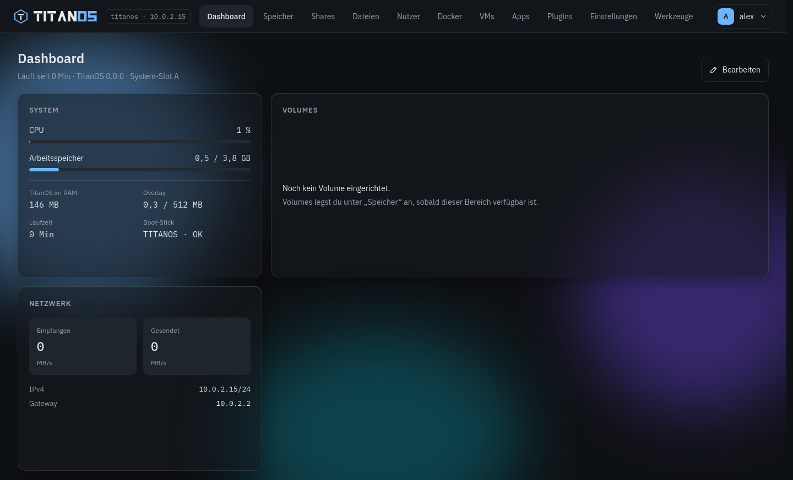

## Was TitanOS ist

TitanOS macht aus einem PC ein NAS. Das System liegt auf einem USB-Stick, wird beim Start komplett in den Arbeitsspeicher geladen und läuft von dort. Der Stick wird danach nur noch angefasst, wenn sich die Konfiguration ändert oder ein Update kommt. Bedient wird alles im Browser.

Die Idee ist von Unraid inspiriert, setzt aber auf klassisches RAID. TitanOS ist ein eigenständiges Projekt und steht in keiner Verbindung zu Lime Technology. Es basiert auf Debian.

## Was schon funktioniert

- **Start vom Stick, Betrieb im RAM.** Das Systemabbild (275 MB) wird beim Booten in den Arbeitsspeicher kopiert, darüber liegt eine auf 512 MB begrenzte Schreibschicht. Nach dem Start belegt das Grundsystem rund 0,6 GB RAM.
- **Konfiguration auf dem Stick.** Alles Dauerhafte liegt im Ordner `config` auf dem Stick. Der Stick wird nur bei Bedarf eingebunden und nach 30 Sekunden ohne Zugriff wieder ausgehängt – ein Stromausfall trifft ihn so fast nie im eingebundenen Zustand.
- **Ersteinrichtung und Anmeldung.** Beim ersten Start legst du das Besitzerkonto mit frei gewähltem Namen an; ein kurzer Assistent fragt danach Name und Zeitzone ab. Es gibt kein festes „admin“ und keinen Login als root. Wiederholte Fehlversuche werden ausgebremst, und jedes Konto lässt sich mit einem zweiten Faktor (Code aus einer Authenticator-App) schützen.
- **HTTPS von Anfang an.** Die Weboberfläche läuft über HTTPS mit einem selbstsignierten Zertifikat, das über Neustarts gleich bleibt.
- **Dashboard mit frei anordenbaren Kacheln.** Kacheln rasten in einem Raster aus 12 Spalten ein, lassen sich verschieben, in der Größe ändern und ausblenden. Das Layout wird pro Konto gespeichert.
- **Darstellung nach Wunsch.** Themes, Akzentfarben, Glas-Effekt, Eckenradius, Schriftgröße, Dichte und Hintergrund, mit Vorschau und Export als Datei.
- **Klassisches RAID.** Volumes mit RAID 0, 1, 5, 6 und 10 über Linux-Software-RAID (mdadm) mit ext4 oder XFS. Fällt eine Platte aus, lässt sie sich in der Oberfläche entfernen und ersetzen; Wiederaufbau und Prüfung zeigen ihren Fortschritt.
- **Freigaben.** SMB mit Rechten pro Konto, Gastzugriff nur lesend, Papierkorb und Time-Machine-Ziel; NFS für ausgewählte Rechner. Dazu fertige Adressen zum Verbinden.
- **Dateimanager im Browser.** Dateien und ganze Ordner hochladen, auch per Drag-and-drop; große Uploads lassen sich pausieren und nach einer Unterbrechung fortsetzen. Dazu herunterladen (auch als Zip), umbenennen und löschen in den Papierkorb.
- **Docker.** Die Engine speichert alles auf einem Volume deiner Wahl. Die Übersicht zeigt Container und Stacks mit CPU, RAM, Ports und Update-Hinweisen, dazu Start, Stopp, Logs und eine Konsole im Browser. Jede App lässt sich als Formular oder als Compose-Datei bearbeiten.
- **App-Store.** Ein kleiner eingebauter Katalog und eigene Quellen (Repository, Archiv oder Compose-Datei), darunter CasaOS-kompatible Stores mit mehreren hundert Apps. Beim Installieren füllt TitanOS Zeitzone, Pfade, freie Ports und Geheimnisse selbst aus und zeigt bei jedem Feld, woher der Wert kommt.
- **Virtuelle Maschinen.** KVM/QEMU mit UEFI: VMs anlegen, starten und stoppen, mit dem Bildschirm der VM direkt im Browser. Kerne festlegen, vorhandene Abbilder und ganze Platten nutzen, Grafikkarten und USB-Geräte durchreichen, NAS-Ordner in der VM einbinden, TPM 2.0 und Secure Boot.
- **Netzwerk.** Feste Adresse, Bonding, VLAN und eine Bridge, über die VMs eine eigene Adresse im Heimnetz bekommen. Jede Änderung gilt erst auf Probe: Ohne Bestätigung innerhalb von zwei Minuten kehrt das NAS zur alten Einstellung zurück.
- **Benachrichtigungen.** Fällt eine Platte aus, läuft ein Wiederaufbau oder wird ein Volume voll, steht das in der Weboberfläche und kommt auf Wunsch per E-Mail, ntfy, Telegram oder Discord.
- **Sicherung des Sticks.** Die Konfiguration liegt nur auf dem Stick, deshalb legt TitanOS nach jeder Änderung eine Kopie auf ein Volume. Geht der Stick kaputt, findet ein neuer Stick die Kopie auf den Platten und spielt sie zurück.
- **Platten vorbereiten.** Neue Platten lassen sich vor dem Einbau prüfen: ganz lesen oder überschreiben und zurücklesen, danach der lange Selbsttest der Platte.
- **Protokoll und Diagnosepaket.** Die Meldungen des Systems im Browser, nach Quelle und Stufe gefiltert. Für Fehlerberichte packt TitanOS Protokolle und Systemzustand in eine Zip-Datei und entfernt vorher Adressen, Namen und alles, was nach Passwort oder Schlüssel aussieht.
- **Plugins.** Systemerweiterungen für Treiber und Werkzeuge, die auf einem Volume liegen und sich ein- und ausschalten lassen. Das Grundgerüst steht; fertige Plugins wie der NVIDIA-Treiber fehlen noch.
- **Terminal.** Eine Shell auf dem NAS und Konsolen in Containern als Tabs am unteren Rand jeder Seite – nur für Administratoren und erst nach erneuter Passwort-Eingabe.
- **Konten mit Rollen.** Besitzer, Administratoren und Benutzer; jedes Konto gilt für die Weboberfläche und für SMB.
- **Deutsch und Englisch.**

<table>
  <tr>
    <td width="50%">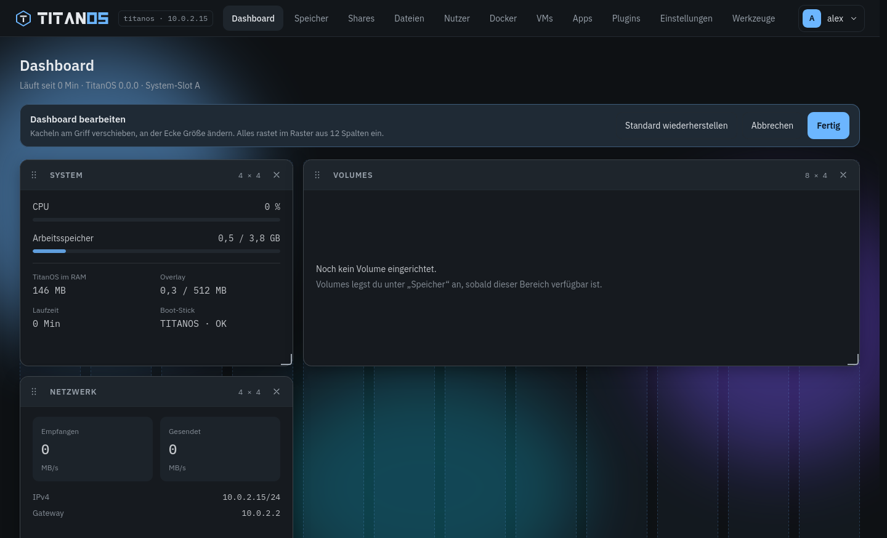</td>
    <td width="50%">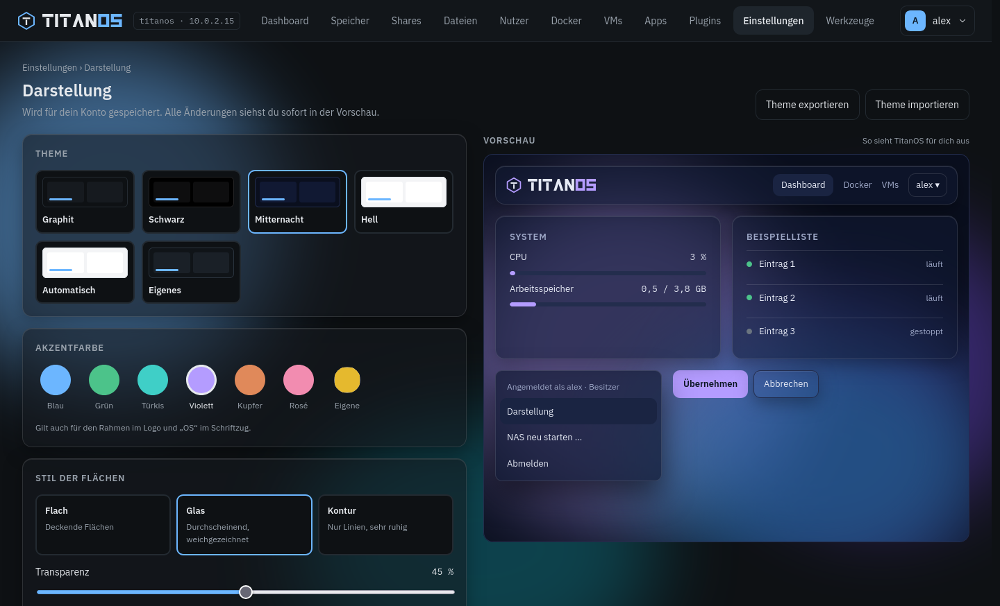</td>
  </tr>
  <tr>
    <td align="center">Dashboard bearbeiten</td>
    <td align="center">Einstellungen › Darstellung</td>
  </tr>
</table>

<table>
  <tr>
    <td width="50%">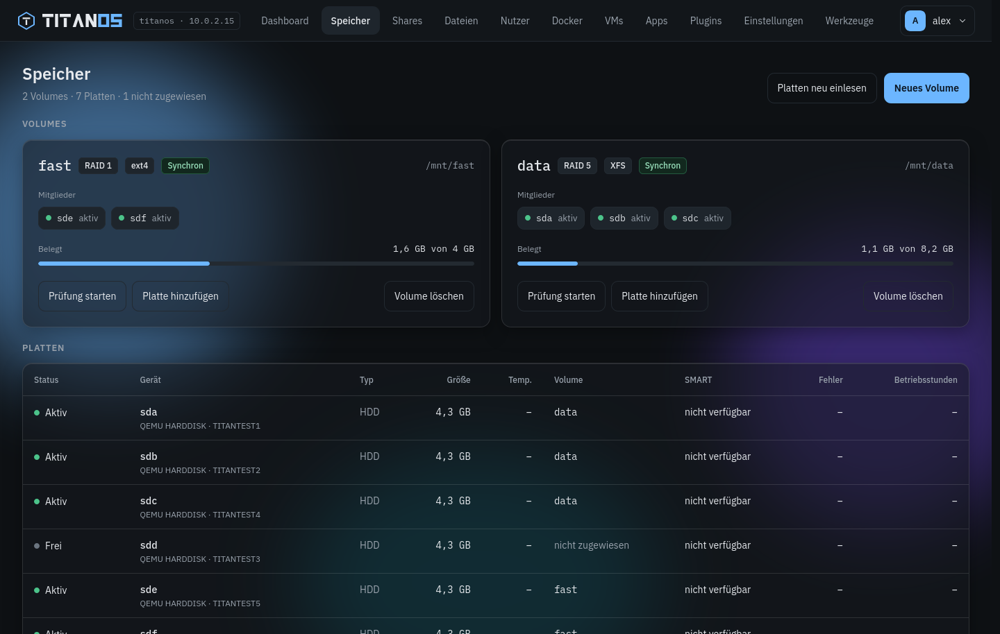</td>
    <td width="50%">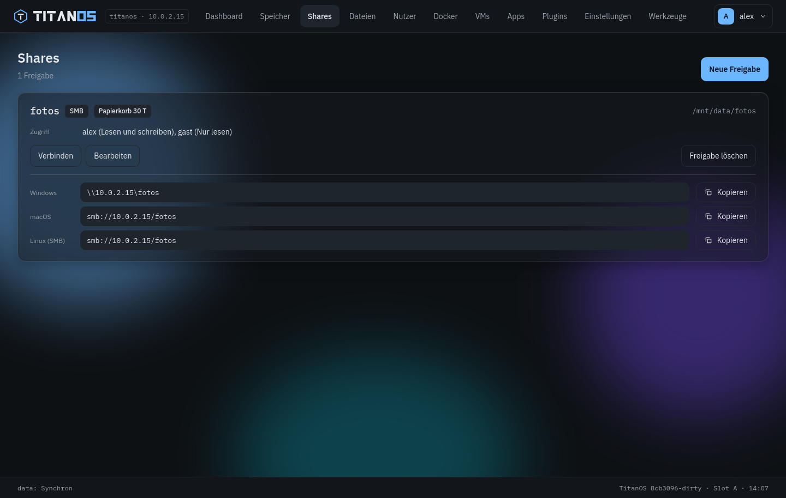</td>
  </tr>
  <tr>
    <td align="center">Speicher</td>
    <td align="center">Shares</td>
  </tr>
</table>

  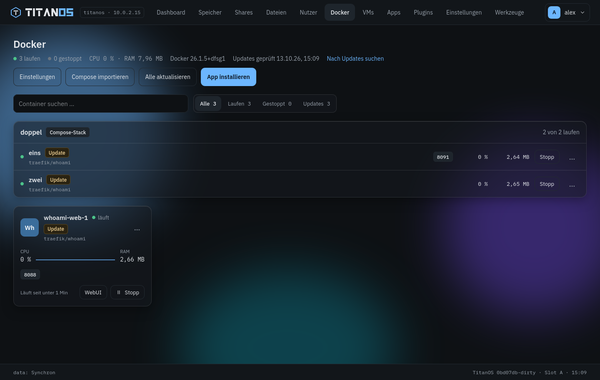 
  Docker

<table>
  <tr>
    <td width="50%">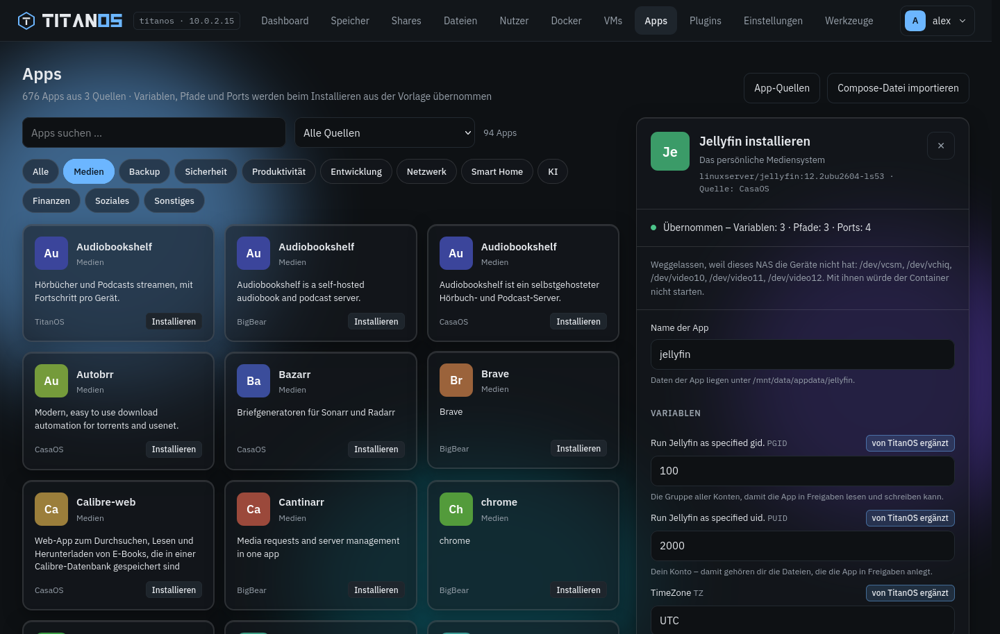</td>
    <td width="50%">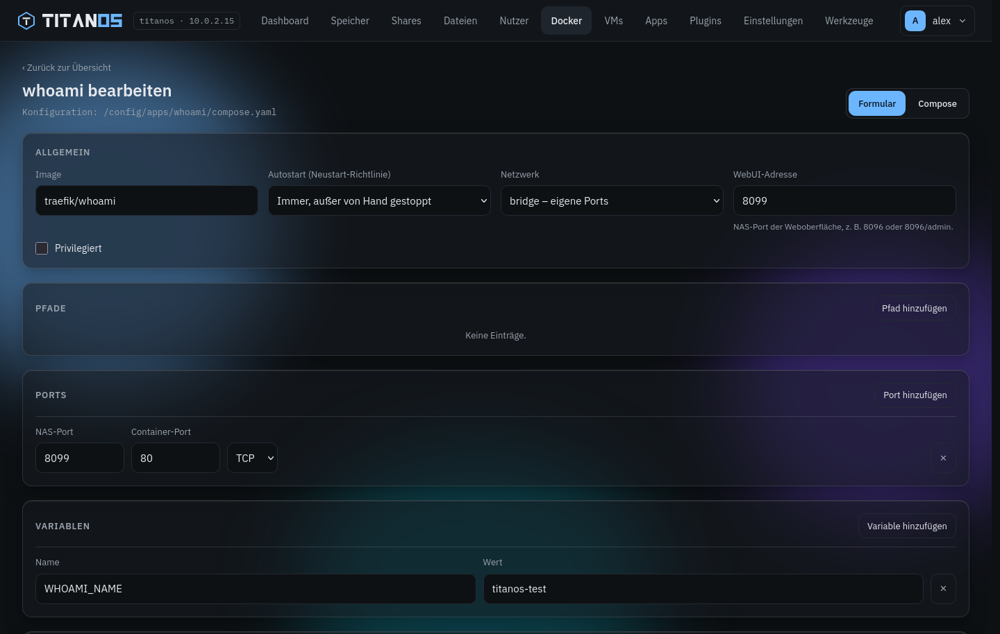</td>
  </tr>
  <tr>
    <td align="center">App-Store</td>
    <td align="center">Container bearbeiten</td>
  </tr>
</table>

<table>
  <tr>
    <td width="50%">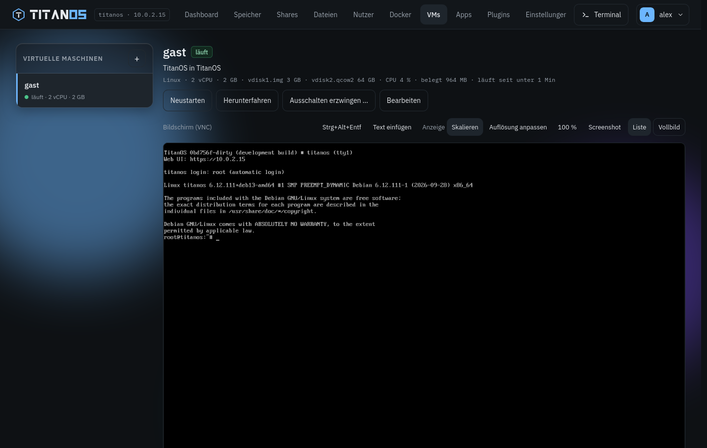</td>
    <td width="50%">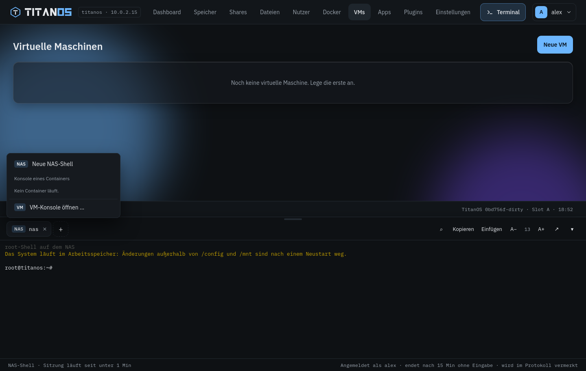</td>
  </tr>
  <tr>
    <td align="center">Virtuelle Maschinen</td>
    <td align="center">Terminal</td>
  </tr>
</table>

  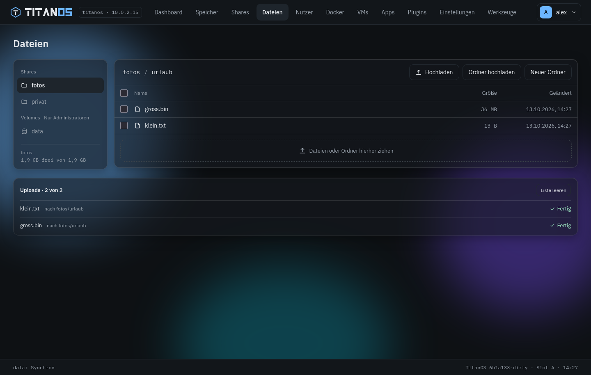 
  Dateimanager

  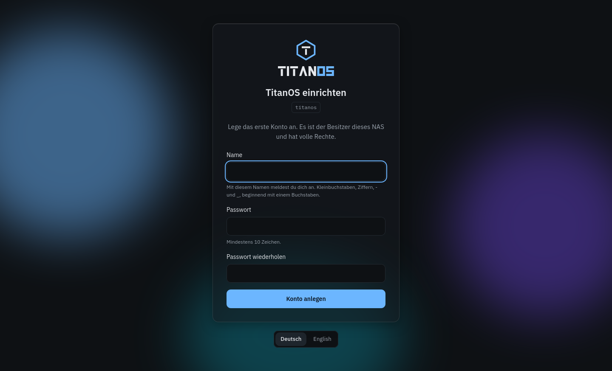 
  Ersteinrichtung beim ersten Start

## Was geplant ist

- **Btrfs-Spiegel mit Snapshots** als Alternative zum klassischen RAID.
- **Fertige Plugins.** Zuerst der NVIDIA-Treiber; dazu Grafikkarten und Beschleuniger für Container.
- **Sichere Updates.** Signierte Updates aus den GitHub-Releases in einen zweiten System-Slot auf dem Stick, mit automatischer Rückkehr zur alten Version, falls die neue nicht startet.

## Installation (geplant)

1. USB-Stick (8–32 GB) als FAT32 mit dem Namen `TITANOS` formatieren.
2. Das neueste `titanos-x.y.z.zip` aus den [Releases](https://github.com/ra5on/TitanOS/releases) laden, Prüfsumme vergleichen und auf den Stick entpacken.
3. Das NAS vom Stick starten (UEFI, Secure Boot aus) und im Browser `https://<nas-ip>` öffnen. Das Zertifikat ist selbstsigniert, der Browser fragt deshalb einmal nach einer Bestätigung.

## Entwicklung

Voraussetzungen: Go 1.27+, Node.js 24+ und `make`.
Für das Systemabbild zusätzlich (Debian 13): `mkosi squashfs-tools mtools zip systemd-boot-efi systemd-container`, zum Testen `qemu-system-x86 ovmf`. Root-Rechte sind nicht nötig.

| Befehl | Was er tut |
|---|---|
| `make build` | Baut die Weboberfläche und `backend/bin/titand` mit eingebetteter Oberfläche |
| `make test` | Führt die Go-Tests und die Typprüfung der Weboberfläche aus |
| `make dev` | Startet `titand` im Entwicklungsmodus auf `127.0.0.1:8080` (ohne HTTPS, Konfiguration in `test/config/`) und den Vite-Server mit automatischem Neuladen |
| `make zip` | Baut das Systemabbild und packt den Stick-Inhalt: `out/stick/` und `out/titanos-<version>.zip` |
| `make zip-dev` | Dasselbe als Entwicklungsvariante, bei der root an der Konsole automatisch angemeldet ist |
| `make qemu` | Startet `out/stick/` in QEMU (UEFI) von einem emulierten USB-Stick; Weboberfläche unter `https://127.0.0.1:8443`. Mit `DISKS=4 make qemu` kommen vier leere Testplatten dazu. |

Das Backend (`backend/`, Go) und die Weboberfläche (`web/`, Svelte + TypeScript) liegen in diesem Repository. Ein einfaches `go build` oder `go test` funktioniert ohne Node.js und enthält statt der Weboberfläche eine Platzhalterseite.

## Lizenz

TitanOS ist **Fair Source** unter der [Functional Source License 1.1 (FSL-1.1-ALv2)](LICENSE.md):

- Nutzen, Ändern und Weitergeben ist frei – privat, im Unternehmen, für Lehre und Forschung.
- Nicht erlaubt: TitanOS oder ein wesentlich darauf beruhendes Produkt als konkurrierendes kommerzielles Produkt oder als Dienst anzubieten.
- Jede Version steht zwei Jahre nach ihrem Erscheinen unter der **Apache License 2.0**.

Maßgeblich ist der Lizenztext in [LICENSE.md](LICENSE.md). Fremdkomponenten (Linux-Kernel, Debian-Pakete und andere) behalten ihre eigenen Lizenzen, siehe [THIRD_PARTY_LICENSES](THIRD_PARTY_LICENSES).

## Mitmachen

Beiträge sind willkommen – bitte lies zuerst [CONTRIBUTING.md](CONTRIBUTING.md) (auf Englisch). Sicherheitslücken bitte nicht öffentlich melden, sondern wie in [SECURITY.md](SECURITY.md) beschrieben.
