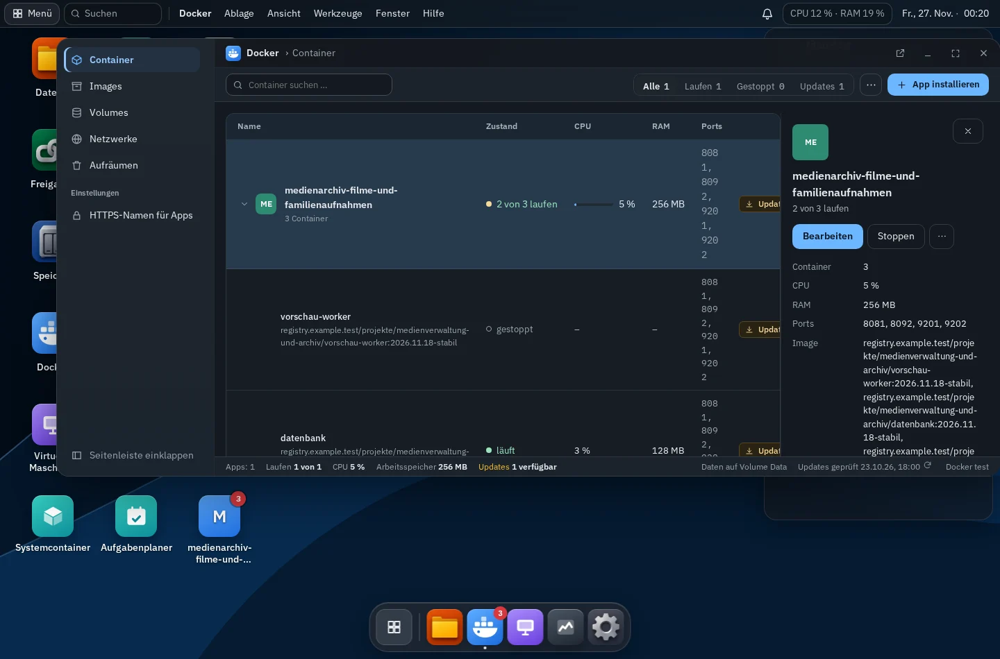
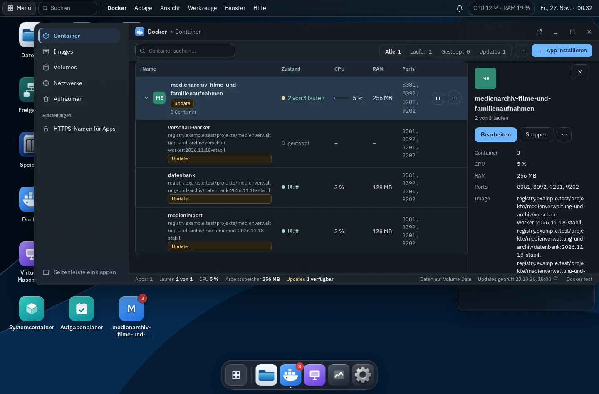

# Nordlicht · Cluster und Docker

Bei identischem Fenster und aufgeklapptem Stack nahm die Liste im veröffentlichten 1.33.0 neben der Detailansicht 797 CSS-Pixel ein und benötigte 924. Der Dokumentrand war breit genug. Die Zeilen nutzten die Breite des Browserfensters für ihre Spalten, obwohl Seitenleiste und Detailansicht der Liste Platz abnahmen. Lange Image-Namen verhinderten das Schrumpfen der Mitgliederzeilen.

| 1.33.0 | Korrektur |
|---|---|
|  |  |

Im korrigierten Chromium-Build beträgt die benötigte Breite 797 Pixel bei 797 verfügbaren. Der Test öffnet das reguläre Docker-Fenster mit drei Testcontainern, mehreren veröffentlichten Ports und langen Namen. Er prüft dasselbe Fenster in WebKit und Chromium, die Seitenleiste, Maximieren, 125-Prozent-Vergrößerung, drei Ressourcentabellen und einen aufgeklappten Container auf dem Smartphone.

Der mobile Cluster-Test startet über die normale Startseite und das alternative Raster. Er schaltet auf einen zweiten Testknoten, prüft die API-Zuordnung beim Öffnen von Dateien und Docker, lädt neu und schaltet zurück. Hinzu kommen einzelne Geräte, fehlende Verbindung und unterschiedliche Kontorechte. Die Knoten sind lokale API-Testdaten. WebKit unter Linux mit simulierter Home-Bildschirm-Anzeige prüft Layout und Bedienung. Für iOS-Geräte, die Safari-Systemleiste und einen tatsächlich installierten Home-Bildschirm-Starter steht der Gerätetest aus.

Der Layoutvergleich verwendet den historisch ausgewählten Nordlicht-Entwurf. Der beschriftete Clusterzugang und die drei Ersatzmotive folgen der späteren Korrektur. Für ihre genaue Zeichnung gab es keine bestätigte Einzelvorlage. Alle veröffentlichten Bilder zeigen ausschließlich generierte Testdaten. Die Agent-Oberfläche folgt separat.
